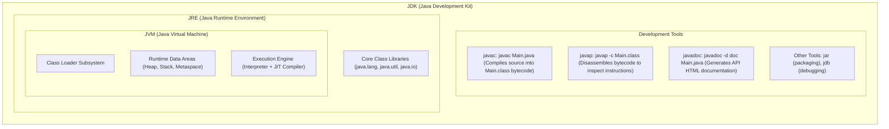
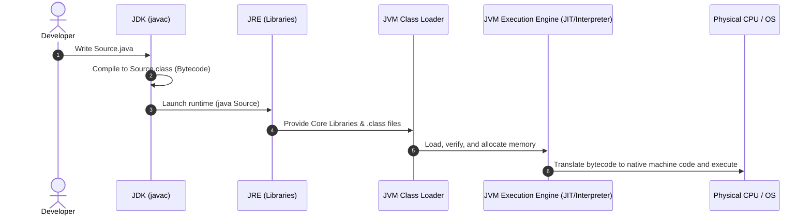

# JDK, JRE, and JVM Architecture in Java

The relationship between the **JDK**, **JRE**, and **JVM** is best understood as a set of nested layers, each serving a specific phase of the software lifecycle—from writing code to executing it on physical hardware.

---

## 1. JDK (Java Development Kit): The Developer's Toolkit

The **JDK** is the outermost layer and the complete environment required to develop and run Java applications.

* **What it does:** Provides compilers and tools needed to translate human-readable Java source code into machine-independent bytecode.
* **Key Components:**
  * **Development Tools:**
    * `javac`: Java compiler (e.g., `javac Main.java` -> compiles source into `Main.class` bytecode).
    * `javap`: Java class disassembler (e.g., `javap -c Main.class` -> prints disassembled bytecode instructions).
    * `javadoc`: Documentation generator (e.g., `javadoc -d doc Main.java` -> builds HTML API documentation from doc comments).
    * `jar` & `jdb`: Archiver (`jar -cvf app.jar ...`) and debugger (`jdb Main`).
  * **The JRE:** Physically contains the JRE inside it so that developers can run and test code immediately after compiling.
* **Workflow Role:** When you run `javac test.java`, the JDK compiles your source code into `test.class` (bytecode).

---

## 2. JRE (Java Runtime Environment): The Execution Context

The **JRE** is the middle layer. It is the minimum environment required to execute a compiled Java application without compilation or debugging tools.

* **What it does:** Creates the runtime environment in which the JVM executes by providing necessary standard class libraries and supporting files.
* **Key Components:**
  * **Core Libraries:** Standard Java Class Libraries (such as `java.util`, `java.lang`, `java.io` in modules / `rt.jar`).
  * **The JVM:** Physically embeds the JVM to execute the bytecode.
* **Workflow Role:** When you run `java test`, the JRE bundles `test.class` with the required core libraries and hands them over to the JVM for execution.

---

## 3. JVM (Java Virtual Machine): The Execution Engine

The **JVM** is the innermost core. It is an abstract virtual computing machine that physically executes bytecode on the host operating system.

> [!NOTE]
> The JVM is **platform-dependent** (different builds exist for Windows, macOS, and Linux). This platform dependency of the JVM is what enables Java bytecode to be **platform-independent** (*"Write Once, Run Anywhere"*).

The JVM operates across three primary subsystems:

### A. Class Loader Subsystem
* **Loading:** Loads `.class` files into memory.
* **Linking:** Verifies bytecode structure, enforces security constraints, prepares static fields, and resolves symbolic references.
* **Initialization:** Initializes static variables and executes `static` blocks.

### B. Runtime Data Areas (Memory Mapping)
* **Method Area / Metaspace:** Stores class-level data, metadata, static variables, and bytecode for methods.
* **Heap:** Stores all instantiated objects (created via `new`). Shared among all threads and managed by the Garbage Collector.
* **Stack:** Stores stack frames for method invocations, holding local variables, parameter values, and partial execution results for individual threads.
* **PC Registers & Native Method Stacks:** Track the current instruction address and native OS method execution.

### C. Execution Engine
Translates bytecode into native host machine code using a hybrid approach:
* **Interpreter:** Reads and executes bytecode instructions sequentially line by line.
* **JIT (Just-In-Time) Compiler:** Monitors code during execution to identify "hot spots" (frequently repeated methods or loops) and compiles them directly into native machine instructions to optimize subsequent executions.
* **Garbage Collector (GC):** Automatically tracks and cleans unreferenced objects from the Heap.

---

## Complete Execution Pipeline

1. **Write:** You write `Source.java` in the development environment.
2. **Compile:** JDK's `javac` compiler converts `Source.java` into platform-independent bytecode `Source.class`.
3. **Launch:** JRE provides standard libraries and initializes the JVM.
4. **Load:** The JVM Class Loader loads `.class` files and allocates runtime memory areas (Metaspace, Heap, Stack).
5. **Execute:** The JVM Execution Engine (Interpreter + JIT Compiler) translates bytecode into host-specific native instructions and executes them on the CPU.

---

## Summary Comparison

| Feature | JDK (Java Development Kit) | JRE (Java Runtime Environment) | JVM (Java Virtual Machine) |
| :--- | :--- | :--- | :--- |
| **Layer** | Outermost layer | Middle layer | Innermost core |
| **Primary Purpose** | Full development and execution environment | Runtime execution environment only | Bytecode execution engine |
| **Contains** | JRE + Development tools (`javac`, `jdb`, `javadoc`, etc.) | JVM + Core Libraries (`java.lang`, `java.util`, etc.) | Class Loader + Memory Areas + Execution Engine |
| **Target User** | Developers | End users / Application servers | Software runtime internals |
| **Platform Dependency**| Platform-dependent installer | Platform-dependent installer | Platform-dependent software |
