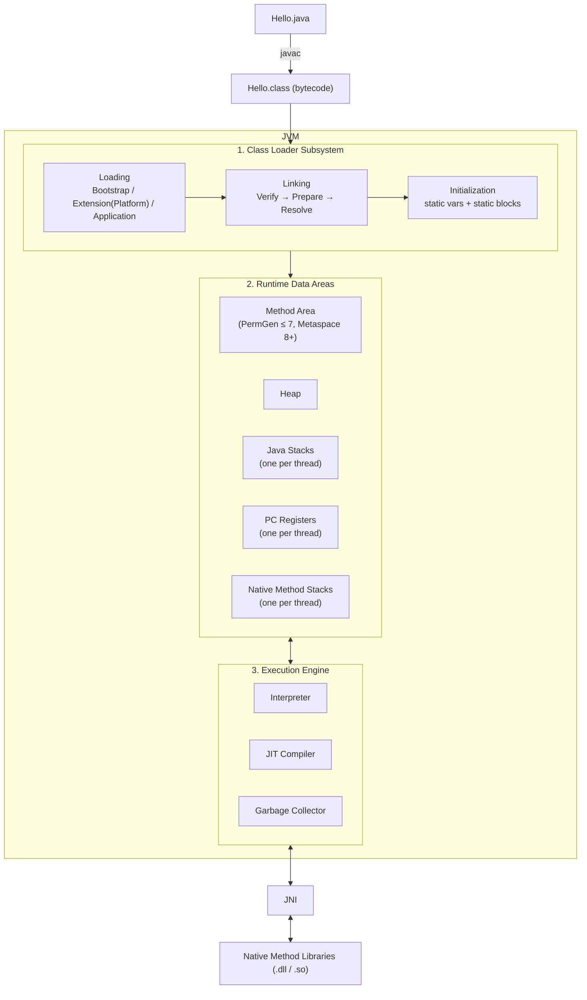
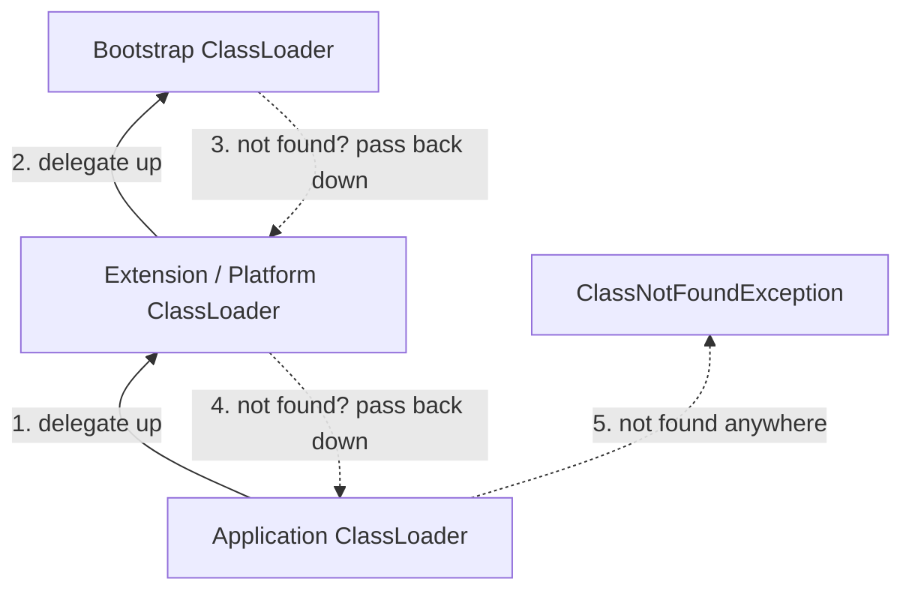
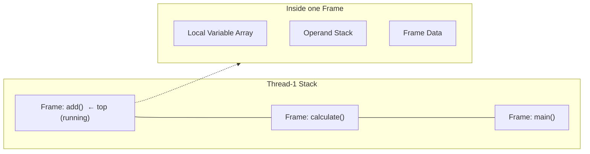
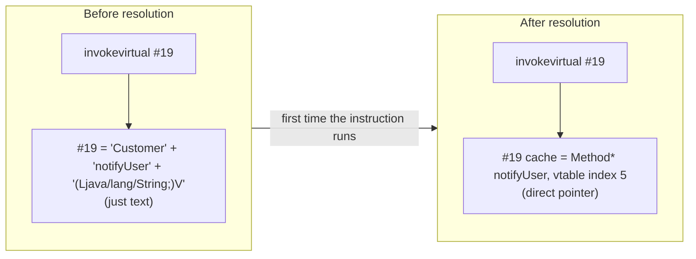
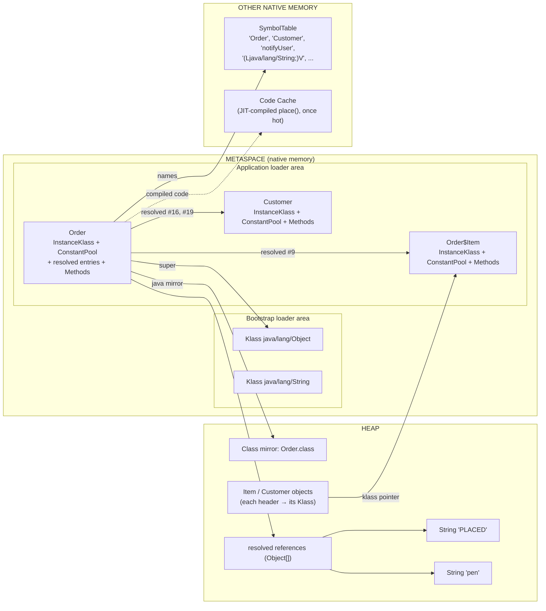
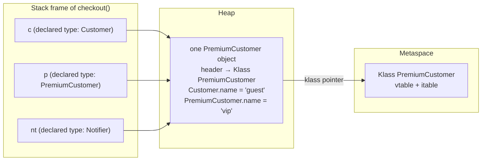
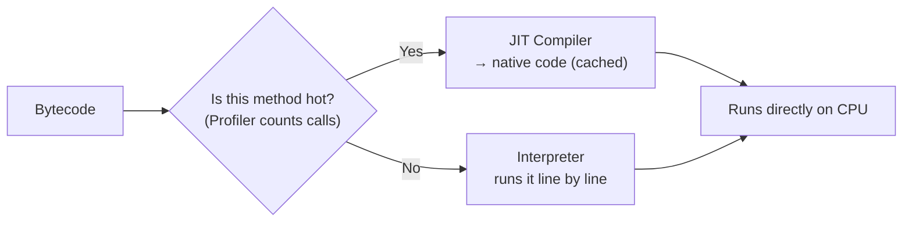

# JVM Architecture: From `.class` File to Execution

> [!info] Source
> Based on **"JVM (Java Virtual Machine) Architecture - tutorial"** by *Ranjith Ramachandran* (~29 min).
> The video walks through the JVM end to end: the class loader subsystem, the runtime data areas, the execution engine, and the **PermGen → Metaspace** change in JDK 8.
> Sections marked **💡 Extra** are my own additions on top of the video.

See also: [[JdkJreJvm]] for how the JDK, JRE and JVM fit inside each other.

---

## The Big Picture

A `.java` file is compiled by `javac` into a `.class` file holding **bytecode**. The JVM is the program that reads that bytecode and runs it on the real machine.

The JVM has **three main parts**:

1. **Class Loader Subsystem**: gets classes into memory (Load → Link → Initialize)
2. **Runtime Data Areas**: the memory the JVM uses while running
3. **Execution Engine**: actually runs the bytecode (Interpreter + JIT + GC)

It also talks to the OS through the **Java Native Interface (JNI)** and **native method libraries**.



---

## 1. Class Loader Subsystem

The class loader's job is to **find a `.class` file, load it, check it, and get it ready to run**. Classes are loaded **lazily**: the first time your code actually needs them, not all at startup.

It has three phases: **Loading → Linking → Initialization**.

### 1.1 Loading

Reads the `.class` file (from disk, a JAR, or the network) and creates a `java.lang.Class` object for it in the heap. The class's details (name, parent, methods, fields, constant pool) are stored in the **Method Area**.

There are three built-in class loaders, arranged as a hierarchy:

| Class Loader | Loads | Where from |
|---|---|---|
| **Bootstrap** | Core Java classes (`java.lang.*`, `java.util.*`, …) | `rt.jar` (JDK ≤ 8) / `java.base` module (JDK 9+) |
| **Extension** (renamed **Platform** in JDK 9+) | Extension classes | `jre/lib/ext` (JDK ≤ 8) / platform modules (9+) |
| **Application** (System) | Your classes | Classpath (`-cp`, `CLASSPATH`) |

Bootstrap is written in native code (C/C++), so `String.class.getClassLoader()` returns `null`.

#### Delegation Hierarchy Principle

When a class is requested, the class loader **asks its parent first**:



- Application asks Extension, Extension asks Bootstrap.
- If Bootstrap can't find it, it passes the job back down; each loader tries its own location.
- If nobody finds it → `ClassNotFoundException`.

**Why it works this way:** you can't replace core classes. If you write your own `java.lang.String`, Bootstrap loads the real one first and yours is never used. That's a security feature.

> [!tip] 💡 Extra: `ClassNotFoundException` vs `NoClassDefFoundError`
> - **`ClassNotFoundException`** (checked exception): you loaded a class *by name at runtime* (`Class.forName("com.x.Driver")`, `loadClass`) and it's not on the classpath.
> - **`NoClassDefFoundError`** (error): the class *was present at compile time* but is missing at runtime, or its static initialization failed earlier. Typical cause: a missing JAR in the deployed app, or a dependency version clash.
> In day-to-day work, both usually mean "check your classpath / dependency tree" (`mvn dependency:tree`).

> [!tip] 💡 Extra: Custom class loaders in real life
> You rarely write one, but you use them constantly: **Tomcat** gives each web app its own loader (so two apps can use different versions of the same library), **Spring Boot** has a `LaunchedURLClassLoader` for fat JARs, and **hot reload** tools (Spring DevTools, JRebel) work by throwing away a class loader and creating a new one. A classic **memory leak** is a class loader that can't be garbage-collected because something static still points at a class it loaded (common on app redeploys).

### 1.2 Linking

Linking has three steps: **Verify → Prepare → Resolve**.

#### a) Verification (Bytecode Verifier)

The **bytecode verifier** checks that the `.class` file is valid and safe before anything runs. It checks things like:

- The file format is correct (starts with the magic number `0xCAFEBABE`, version is supported).
- The bytecode doesn't break the stack (no underflow/overflow of the operand stack).
- Types are used correctly (you don't treat an `int` as an object reference).
- `final` classes are not extended and `final` methods are not overridden.
- Access rules (`private`, etc.) are respected.

If verification fails → **`java.lang.VerifyError`**.

**Why it's needed:** a `.class` file doesn't have to come from `javac`. It could be hand-edited or generated by a tool. Verification makes sure the JVM never runs bytecode that could crash it or get around Java's safety rules. This is a big reason Java is considered secure.

> [!tip] 💡 Extra
> - `UnsupportedClassVersionError` is related: the class was compiled with a newer JDK than the one running it (e.g. compiled on 21, run on 17). Class file major versions: Java 8 = 52, 11 = 55, 17 = 61, 21 = 65, 25 = 69.
> - Verification is the reason bytecode-manipulation libraries (ByteBuddy, ASM, CGLIB, used by Spring proxies, Hibernate and Mockito) must generate *correct* bytecode, or you'll see `VerifyError` at runtime.

#### b) Preparation

Memory is allocated for **static variables**, and they get their **default values** (not your values yet):

```java
static int count = 10;      // after Preparation: 0
static boolean flag = true; // after Preparation: false
static String name = "abc"; // after Preparation: null
```

The real values (`10`, `true`, `"abc"`) are assigned later, in Initialization.

> [!note] 💡 Extra
> `static final` compile-time constants (e.g. `static final int MAX = 10;`) are an exception: they're baked into the class file's constant pool and set directly.

#### c) Resolution

Replaces **symbolic references** with **direct references**.

In the bytecode, a class refers to other classes, methods and fields by **name** (e.g. `"java/lang/String"`). Resolution turns these names into real memory addresses/pointers in the Method Area. If something can't be resolved you get errors like `NoSuchMethodError` or `NoSuchFieldError`.

> [!tip] 💡 Extra
> `NoSuchMethodError` in production is almost always a **dependency version mismatch**: your code was compiled against version X of a library, but version Y (without that method) is on the runtime classpath.

> [!example] Deep dive
> For a step-by-step walkthrough with real `javap` output (String, nested class, other-class and same-class references) and a picture of what Metaspace holds for that example, see [[#2.6 Deep Dive - Resolution and Metaspace]].

### 1.3 Initialization

The final phase of class loading:

- Static variables get their **real values**.
- **`static` blocks** run, top to bottom in source order.
- The parent class is initialized before the child.

```java
class Config {
    static int count = 10;          // assigned now
    static {
        System.out.println("Config class initialized");
    }
}
```

> [!tip] 💡 Extra: When does initialization happen?
> Only on **first active use**: creating an object (`new`), calling a static method, reading/writing a non-constant static field, using reflection (`Class.forName`), or initializing a subclass. This is why the **holder idiom** for a lazy singleton is thread-safe with no locking:
> ```java
> class Singleton {
>     private Singleton() {}
>     private static class Holder { static final Singleton INSTANCE = new Singleton(); }
>     static Singleton getInstance() { return Holder.INSTANCE; } // Holder initialized here, once
> }
> ```
> If a static block throws, you get `ExceptionInInitializerError` the first time, and `NoClassDefFoundError` on every later attempt. That's confusing when debugging, so always look for the *first* error in the logs.

---

## 2. Runtime Data Areas (JVM Memory)

These are the memory areas the JVM uses while your program runs. Some are **shared by all threads**, others are **one per thread**.

| Area | Per thread or shared? | Stores | Error when full |
|---|---|---|---|
| **Method Area** | Shared (1 per JVM) | Class-level data: class structure, method bytecode, constant pool, static variables | `OutOfMemoryError: PermGen space` / `Metaspace` |
| **Heap** | Shared (1 per JVM) | All objects and arrays (`new …`) | `OutOfMemoryError: Java heap space` |
| **Java Stack** | Per thread | One **stack frame** per method call | `StackOverflowError` |
| **PC Register** | Per thread | Address of the current instruction being run | — |
| **Native Method Stack** | Per thread | Info for native (C/C++) method calls | `StackOverflowError` / `OutOfMemoryError` |

### 2.1 Method Area

- One per JVM, shared by all threads.
- Holds **class-level** data: class name, parent class, method and field info, method bytecode, the **runtime constant pool**, and static variables.
- Because it's shared, it's **not thread-safe**. Static variables are shared state, so be careful.

> To see exactly what Metaspace contains for a small example class, see [[#2.6 Deep Dive - Resolution and Metaspace]].

#### PermGen vs Metaspace (JDK 8 change)

| | **PermGen** (JDK ≤ 7) | **Metaspace** (JDK 8+) |
|---|---|---|
| Location | Part of the JVM's heap memory | **Native memory** (outside the heap) |
| Default size | Fixed, small (~64 MB on many setups) | Grows automatically (limited only by available OS memory) |
| Tuning flags | `-XX:PermSize`, `-XX:MaxPermSize` | `-XX:MetaspaceSize`, `-XX:MaxMetaspaceSize` |
| Typical error | `OutOfMemoryError: PermGen space` | `OutOfMemoryError: Metaspace` |

**Why the change:** PermGen had a fixed size, so apps that load lots of classes (app servers, frameworks generating proxy classes, frequent redeploys) kept running out of it. Metaspace grows as needed.

> [!warning] 💡 Extra
> "Grows automatically" doesn't mean "can't leak". A class loader leak in JDK 8+ just becomes a Metaspace leak that slowly uses up the machine's memory. In containers (Docker/Kubernetes), **set `-XX:MaxMetaspaceSize`** so a leak fails clearly instead of the container getting OOM-killed. Also, in JDK 7+ **string literals (the String pool) and static variables moved to the heap**; they don't live in PermGen/Metaspace.

### 2.2 Heap

- One per JVM, shared by all threads.
- Every object and array lives here: `new Employee()`, `new int[10]`, etc.
- Instance variables live inside their object on the heap.
- Managed by the **Garbage Collector**.
- Size set with **`-Xms`** (starting size) and **`-Xmx`** (max size).

```
-Xms512m -Xmx2g
```

> [!tip] 💡 Extra: Heap generations
> The heap is split into generations because most objects die young:
> - **Young Generation**: Eden + two Survivor spaces (S0, S1). New objects are created in Eden. **Minor GC** is frequent and fast.
> - **Old (Tenured) Generation**: objects that survive several minor GCs get promoted here. **Major/Full GC** is slower.
>
> In production, set `-Xms` equal to `-Xmx` to avoid resize pauses, and add `-XX:+HeapDumpOnOutOfMemoryError -XX:HeapDumpPath=/dumps` so you have a heap dump to analyse (Eclipse MAT, VisualVM) when things break. In containers, use `-XX:MaxRAMPercentage=75` instead of a hard-coded `-Xmx`.

### 2.3 Java Stack (one per thread)

- Every thread gets its own stack, created when the thread starts.
- Each **method call pushes a stack frame**; when the method returns, its frame is popped.
- Since each thread has its own stack, data on it is **thread-safe**.

Each **stack frame** has three parts:

1. **Local Variable Array**: method parameters and local variables (`this` at index 0 for instance methods).
2. **Operand Stack**: a work area for intermediate calculations. Bytecode instructions push and pop values here (e.g. `iload_1`, `iload_2`, `iadd`).
3. **Frame Data**: references to the constant pool, info needed to return normally, and the exception table for `catch` blocks.



Too deep a recursion (no base case) → too many frames → **`StackOverflowError`**. Stack size per thread is set with **`-Xss`** (e.g. `-Xss1m`).

> [!tip] 💡 Extra: Where do variables live?
> ```java
> void process() {
>     int x = 5;                    // x (the value 5) → stack
>     Employee e = new Employee();  // the reference 'e' → stack; the Employee object → heap
> }
> ```
> **Local variables live on the stack, objects live on the heap, static variables are class-level** (heap in JDK 8+, tied to the class). This ties in with [[LocalVsInstanceVariables]].
> To see the operand stack instructions yourself: `javap -c -v MyClass.class`.

### 2.4 PC Register (Program Counter)

- One per thread.
- Holds the **address of the bytecode instruction the thread is currently running**. Once it finishes, it points to the next one.
- This is how each thread knows where it left off when the CPU switches between threads.
- For a **native method**, its value is undefined.

### 2.5 Native Method Stack

- One per thread.
- Used when Java calls **native methods** (C/C++ code via JNI), e.g. `Thread.start()`, `System.currentTimeMillis()`, `Object.hashCode()`.
- In HotSpot, the Java stack and native stack are actually combined.

---

### 2.6 Deep Dive - Resolution and Metaspace

> [!info] 💡 Extra
> This section connects **Resolution** (1.2 c) with the **Method Area / Metaspace** (2.1) using one small example. All the bytecode and constant pool listings are real output from `javac` + `javap -v -p` on **JDK 25**. The Metaspace pictures are a **simplified view of HotSpot** (the names like `InstanceKlass` and `Method` are HotSpot's internal C++ structures).

#### The example

```java
public class Order {
    private int qty;

    static class Item {
        String name;
        Item(String name) { this.name = name; }
    }

    void place() {
        String status = "PLACED";        // 1. String reference
        Item item = new Item("pen");     // 2. Nested class reference
        Customer c = new Customer();     // 3. Different class reference
        c.notifyUser(status);            //    ...and a method on it
        validate();                      // 4. Same-class method reference
        qty = 5;                         // 5. Same-class field reference
    }

    private void validate() { }
}

class Customer {
    void notifyUser(String msg) { }
}
```

`javac Order.java` produces **three** class files: `Order.class`, `Order$Item.class` and `Customer.class`. The nested class gets its own file.

#### Step 1 - The bytecode only has names

`javac` doesn't know any memory addresses: the classes aren't loaded yet, and `Customer` might be recompiled separately later. So the bytecode can only refer to things **by name**, through numbered slots in the class's **constant pool**.

Bytecode of `place()` (`javap -c -p Order.class`):

```
 0: ldc           #7    // String PLACED
 2: astore_1
 3: new           #9    // class Order$Item
 6: dup
 7: ldc           #11   // String pen
 9: invokespecial #13   // Method Order$Item."<init>":(Ljava/lang/String;)V
12: astore_2
13: new           #16   // class Customer
16: dup
17: invokespecial #18   // Method Customer."<init>":()V
20: astore_3
21: aload_3
22: aload_1
23: invokevirtual #19   // Method Customer.notifyUser:(Ljava/lang/String;)V
26: aload_0
27: invokevirtual #22   // Method validate:()V
30: aload_0
31: iconst_5
32: putfield      #27   // Field qty:I
35: return
```

The constant pool of `Order` (`javap -v -p Order.class`):

```
 #1 = Methodref    #2.#3     // java/lang/Object."<init>":()V
 #2 = Class        #4        // java/lang/Object
 #3 = NameAndType  #5:#6     // "<init>":()V
 #4 = Utf8         java/lang/Object
 #5 = Utf8         <init>
 #6 = Utf8         ()V
 #7 = String       #8        // PLACED
 #8 = Utf8         PLACED
 #9 = Class        #10       // Order$Item
#10 = Utf8         Order$Item
#11 = String       #12       // pen
#12 = Utf8         pen
#13 = Methodref    #9.#14    // Order$Item."<init>":(Ljava/lang/String;)V
#14 = NameAndType  #5:#15    // "<init>":(Ljava/lang/String;)V
#15 = Utf8         (Ljava/lang/String;)V
#16 = Class        #17       // Customer
#17 = Utf8         Customer
#18 = Methodref    #16.#3    // Customer."<init>":()V
#19 = Methodref    #16.#20   // Customer.notifyUser:(Ljava/lang/String;)V
#20 = NameAndType  #21:#15   // notifyUser:(Ljava/lang/String;)V
#21 = Utf8         notifyUser
#22 = Methodref    #23.#24   // Order.validate:()V
#23 = Class        #25       // Order
#24 = NameAndType  #26:#6    // validate:()V
#25 = Utf8         Order
#26 = Utf8         validate
#27 = Fieldref     #23.#28   // Order.qty:I
#28 = NameAndType  #29:#30   // qty:I
#29 = Utf8         qty
#30 = Utf8         I
...
NestMembers:   Order$Item
InnerClasses:  static Item = class Order$Item of class Order
```

So `invokevirtual #19` really means: *"call the method named `notifyUser`, with descriptor `(String) → void`, on the class named `Customer`."* It's a chain of text entries: `#19 → #16 → #17 "Customer"` and `#19 → #20 → #21 "notifyUser" + #15 "(Ljava/lang/String;)V"`. That chain is a **symbolic reference**.

**Resolution** follows the chain **once**, finds the real thing in memory, and **saves a direct pointer**. Every later run of that instruction uses the saved pointer and never looks at the names again.



> [!note] When does resolution happen?
> The JVM spec allows resolving everything up front or one reference at a time. **HotSpot does it lazily**: each reference is resolved the **first time an instruction that uses it runs**. That's why the first call of a method is a bit slower, and why a missing class can fail deep inside a running app instead of at startup.

#### Step 2 - How each kind of reference gets resolved

##### A. String reference: `"PLACED"`

```
#7 = String  #8      // PLACED
#8 = Utf8    PLACED
0: ldc #7
```

1. Read the characters `PLACED` from `#8`.
2. Look them up in the JVM's **String pool** (`StringTable`).
3. If it's already there, use that `String` object. If not, create a `String` **on the heap** and add it to the pool.
4. Save the reference in the class's **resolved references** array, so later runs of `ldc #7` push it straight onto the operand stack.

Every `"PLACED"` literal in every loaded class ends up pointing to the **same** heap object. That's why `"PLACED" == "PLACED"` is `true`.

This is the one case where the **result is on the heap**. The constant pool entry that points to it is still class metadata in Metaspace.

##### B. Nested class reference: `new Item("pen")`

```
#9  = Class      #10      // Order$Item
#10 = Utf8       Order$Item
#13 = Methodref  #9.#14   // Order$Item."<init>":(Ljava/lang/String;)V
```

**To the JVM, a nested class is just another class.** It has its own file (`Order$Item.class`), its own constant pool, and `Order` refers to it by the name `"Order$Item"`.

- **`new #9`:** ask `Order`'s **own class loader** (the Application loader) to load `"Order$Item"`, with the usual parent-first delegation. Then load, link and initialize it (`new` requires initialization). Save the `Klass*` pointer in slot `#9`.
- **`invokespecial #13`:** look in `Order$Item`'s methods for name `<init>` (the bytecode name for constructors) with descriptor `(Ljava/lang/String;)V`. Save the `Method*`.

The "nested" relationship comes from attributes, not from the lookup itself: `Order` has `NestMembers: Order$Item`, and `Order$Item` has `NestHost: class Order`. Since **JDK 11 (nestmates)**, resolution's **access check** reads these, so the two classes can use each other's `private` members directly. Before JDK 11, `javac` had to generate hidden `access$000()` bridge methods for that.

##### C. Different class reference: `new Customer()` and `c.notifyUser(status)`

```
#16 = Class      #17      // Customer
#18 = Methodref  #16.#3   // Customer."<init>":()V
#19 = Methodref  #16.#20  // Customer.notifyUser:(Ljava/lang/String;)V
```

**Class resolution (`#16`)** works the same as for `Item`: load `"Customer"` through `Order`'s class loader and save the `Klass*`.
- Not found → **`NoClassDefFoundError`**

**Method resolution (`#19`)**, following the JVM spec:
1. Resolve the class first (`#16` → `Customer`).
2. Look for `notifyUser` + `(Ljava/lang/String;)V` in `Customer`, then its superclasses, then its interfaces.
3. Check access: may `Order` call it? (Same package, package-private method, so yes.)
4. Save the `Method*` and, for `invokevirtual`, its **vtable index** (its slot in the class's table of overridable methods).
- Method missing → **`NoSuchMethodError`**
- Access not allowed → **`IllegalAccessError`**

> [!important] Resolution vs dispatch
> **Resolution** happens **once**: it decides *which method signature* the call means and which vtable slot it uses.
> **Dispatch** happens **on every call**: the JVM reads that vtable slot on the object's *real* class. If `c` were a `PremiumCustomer` that overrides `notifyUser`, slot 5 of `PremiumCustomer`'s vtable would point to the override. That's polymorphism, and it's cheap because resolution already worked out the slot number.

> [!question]- 💡 What is a vtable? (and why "index 5")
> Every class in Metaspace has a **vtable** (virtual method table): an array of pointers, **one slot per method that can be overridden**. Each slot points to the code that class runs for that method.
>
> **Rules:**
> 1. A subclass **starts with a copy of its parent's vtable**, so inherited methods keep the **same slot numbers**.
> 2. An **override replaces** the pointer in that same slot.
> 3. **New** methods get **new slots at the end**.
>
> `Object`'s overridable methods (`equals`, `hashCode`, `toString`, `clone`, `finalize`) take slots 0–4 in every class. `Customer` adds one new method, so `notifyUser` gets the next free slot, **5**:
>
> ```
> Object vtable          Customer vtable                 PremiumCustomer vtable
> [0] equals      ──►    [0] Object.equals          ──►  [0] Object.equals
> [1] hashCode    ──►    [1] Object.hashCode        ──►  [1] Object.hashCode
> [2] toString    ──►    [2] Object.toString        ──►  [2] Object.toString
> [3] clone       ──►    [3] Object.clone           ──►  [3] Object.clone
> [4] finalize    ──►    [4] Object.finalize        ──►  [4] Object.finalize
>                        [5] Customer.notifyUser    ──►  [5] PremiumCustomer.notifyUser  ← override, same slot
> ```
> (The order of `Object`'s slots is a HotSpot internal detail. What matters is that inherited slots keep their numbers.)
>
> **Why resolution saves the slot number and not just the method:** the object in `c` might be a subclass:
> ```java
> class PremiumCustomer extends Customer {
>     @Override void notifyUser(String msg) { /* also send SMS */ }
> }
> Customer c = new PremiumCustomer();
> c.notifyUser("PLACED");   // same bytecode: invokevirtual #19
> ```
> Because overrides keep the same slot, **slot 5 means `notifyUser` in every class in the `Customer` hierarchy**. So each call only needs:
> ```
> object header → its Klass (Customer or PremiumCustomer) → vtable[5] → run that method
> ```
> Two pointer lookups and an array read, with no search by name. **This is how runtime method overriding works inside the JVM.**
> - **Resolution** (once): name `notifyUser(String)` → **slot 5**
> - **Dispatch** (every call): **slot 5** of the *actual object's* class → the right method
>
> **No vtable slot (called directly):** `private` methods (like `validate()`), `static` methods, constructors (`<init>`), and in HotSpot, `final` methods that don't override anything.
>
> **Interfaces** use a similar table called the **itable**. It's a bit slower, because a class can implement many interfaces and their slot numbers can't be fixed across all classes.
>
> **The JIT goes further:** if profiling shows `c` is always a `Customer`, it skips the vtable and **inlines** `notifyUser` into `place()`, with a quick type check in case a `PremiumCustomer` ever shows up.

##### D. Same-class method reference: `validate()`

```
#22 = Methodref    #23.#24  // Order.validate:()V
#23 = Class        #25      // Order
#24 = NameAndType  #26:#6   // validate:()V
27: invokevirtual #22
```

**Even a call to your own class is symbolic.** `Order` refers to *itself* by the name `"Order"` (`#23`). The class file format has no shortcut like "this class, method number 3".

1. Resolve `#23` → `"Order"`. It's the class that's already running, so it's found straight away.
2. Look up `validate:()V` in `Order` and save the `Method*`.
3. `validate` is `private`, so it **can't be overridden**. The JVM calls it **directly**, without going through the vtable.

> [!tip] Why `invokevirtual` for a private method?
> Since JDK 11, `javac` emits `invokevirtual` (not `invokespecial`) for private methods, another nestmate change. The JVM sees that the resolved method is private and still calls it directly.

##### E. Same-class field reference: `qty = 5`

```
#27 = Fieldref  #23.#28  // Order.qty:I
32: putfield #27
```

Resolution finds field `qty` of type `I` (int) in `Order` and saves its **byte offset inside an `Order` object** (e.g. 12, right after the default 12-byte object header). From then on, `putfield` just writes `5` at *object address + 12*.

#### Step 3 - What Metaspace looks like for this example

Metaspace is **native memory** (outside the heap), split into **one area per class loader**. Our three classes are loaded by the **Application class loader**, so their metadata sits together in its area. `java.lang.Object` and `java.lang.String` were loaded by the **Bootstrap** loader, so theirs sits in the boot loader's area.

Metaspace itself has two parts:
- **Compressed Class Space**: holds the `Klass` structures (the class "headers"). It's a separate fixed-size region (`-XX:CompressedClassSpaceSize`, 1 GB reserved by default) so objects can point to their class with a small 32-bit pointer.
- **Non-class Metaspace**: everything else: constant pools, methods, bytecode, profiling data, annotations.

##### The big picture



##### Inside Metaspace for `Order` (after `place()` has run once)

```
METASPACE  ─ Application class loader area
│
├── InstanceKlass "Order"                          [Compressed Class Space]
│     name ............ → Symbol "Order"
│     super ........... → Klass java/lang/Object   (Bootstrap area)
│     class loader .... → Application ClassLoader
│     java mirror ..... → java.lang.Class object for Order   (HEAP)
│     access flags .... public
│     init state ...... fully initialized
│     fields .......... qty : int, private, offset 12
│     methods ......... → [ <init>(), place(), validate() ]
│     vtable .......... [0..4] inherited from Object
│                              (equals, hashCode, toString, clone, finalize)
│                       [5]    place()
│                       (validate is private and <init> is a constructor,
│                        so neither goes in the vtable)
│     itable .......... empty (Order implements no interfaces)
│     nest members .... → Order$Item
│     inner classes ... Item = static class Order$Item of Order
│     constant pool ... → (below)
│
├── ConstantPool of "Order"  (~38 slots)           [non-class Metaspace]
│     tags ............ Methodref, Class, NameAndType, Utf8, String, Fieldref ...
│     Utf8 slots ...... → shared Symbols ("Customer", "notifyUser", ...)
│     resolved refs ... → Object[] on HEAP holding "PLACED" and "pen"
│
├── Resolved entries (the constant pool "cache")   [non-class Metaspace]
│     #7   String     "PLACED"        → resolved references → HEAP String
│     #11  String     "pen"           → resolved references → HEAP String
│     #9   Class      Order$Item      → Klass* Order$Item
│     #13  Methodref  Item.<init>     → Method* Order$Item.<init>(String)
│     #16  Class      Customer        → Klass* Customer
│     #18  Methodref  Customer.<init> → Method* Customer.<init>()
│     #19  Methodref  notifyUser      → Method* Customer.notifyUser, vtable index 5
│     #22  Methodref  validate        → Method* Order.validate, private → direct call
│     #27  Fieldref   qty             → offset 12, type int
│     #1   Methodref  Object.<init>   → Method* Object.<init>  (resolved when an Order was constructed)
│
└── Methods                                        [non-class Metaspace]
      Method place()
        ConstMethod ... bytecode (36 bytes: 0..35), max_stack = 3, max_locals = 4
                        (this, status, item, c), line number table
        MethodCounters  how many times it was called, loop counts
        MethodData .... profiling for the JIT, e.g. "at invokevirtual #19
                        the receiver was always Customer"
        code .......... → JIT-compiled version in the CODE CACHE (only once hot)
      Method validate()  bytecode: 1 byte (return), max_stack = 0, max_locals = 1
      Method <init>()    calls Object.<init>, max_stack = 1, max_locals = 1
```

##### `Order$Item` and `Customer` (same area, own structures)

```
├── InstanceKlass "Order$Item"
│     super ........... → Klass java/lang/Object
│     fields .......... name : String, offset 12 (a compressed reference)
│     methods ......... → [ <init>(String) ]
│     vtable .......... [0..4] inherited from Object
│     nest host ....... → Order
│     constant pool ... own pool (~22 slots), e.g. #7 Fieldref Order$Item.name
│
├── InstanceKlass "Customer"
│     super ........... → Klass java/lang/Object
│     fields .......... none
│     methods ......... → [ <init>(), notifyUser(String) ]
│     vtable .......... [0..4] inherited from Object
│                       [5]    notifyUser(String)   ← the "vtable index 5" saved in Order's #19
│     constant pool ... own pool (~14 slots)
```

The name `"Customer"` appears in **both** `Order`'s pool (`#17`) and `Customer`'s own pool (`#8`). The JVM stores it **once** as a shared **Symbol**, and both pools point to it. Symbols live in the `SymbolTable`, which is native memory but not Metaspace.

##### What lives where, for this example

| Thing | Where | Why |
|---|---|---|
| `InstanceKlass` for `Order`, `Order$Item`, `Customer` (incl. vtables) | **Metaspace**, Compressed Class Space | Every object header points here; a compact 32-bit pointer needs a dedicated region |
| Constant pools, resolved entries, `Method`, bytecode, `MethodData`, `MethodCounters` | **Metaspace**, non-class part | Class metadata that lives as long as the class |
| Names like `"Order"`, `"notifyUser"`, `"(Ljava/lang/String;)V"` | **SymbolTable** (native) | Shared by all classes, stored once |
| `Order.class`, `Item.class`, `Customer.class` mirror objects | **Heap** | What Java code sees through `getClass()` and reflection. Static fields live here since JDK 7 (this example has none) |
| `"PLACED"`, `"pen"` and the resolved references array | **Heap** | Regular Java objects, held in the String pool |
| `Item` and `Customer` objects created in `place()` | **Heap** | Created with `new`; each object's header points to its `Klass` in Metaspace |
| `status`, `item`, `c` local variables | **Thread stack** (frame of `place()`) | Locals; 4 slots including `this` |
| JIT-compiled machine code for `place()` | **Code Cache** (native) | Only if the method gets hot |

#### Why the resolution data has to be in Metaspace

1. **Resolution reads class metadata.** The constant pool and method tables that resolution walks *are* class metadata, and since JDK 8 that's what Metaspace holds.
2. **It lives as long as the class does.** This data must stay until the **class loader that loaded the class is unloaded**, not until some object dies. Metaspace is organized per class loader, so unloading one frees all of its classes in one go. (The Application loader is never unloaded, so `Order`'s metadata stays for the whole run.)
3. **Its addresses must never change.** JIT-compiled code puts `Method*` and `Klass*` addresses directly into machine instructions. The GC **moves** heap objects around when it compacts, which would break those pointers. Metaspace data doesn't move.
4. **The GC doesn't need to scan it.** Keeping class metadata off the heap means GC cycles don't waste time on it, and it doesn't use up `-Xmx`.
5. **It's the JVM's own internal data.** These are C++ structures that the interpreter and JIT read directly; they aren't Java objects.

#### See it yourself

```bash
javap -v -p Order.class                                # constant pool + bytecode
java -Xlog:class+load=info -Xlog:class+resolve=debug Order   # watch classes load and references resolve
jcmd <pid> VM.metaspace                                # Metaspace usage by loader, class vs non-class
jcmd <pid> VM.classloader_stats                        # classes and metadata size per class loader
java -XX:NativeMemoryTracking=summary ...              # then: jcmd <pid> VM.native_memory summary
                                                       # "Class" = Metaspace, "Symbol" = SymbolTable
```

#### How this shows up in day-to-day work

- **`NoSuchMethodError` after a dependency upgrade.** The descriptor includes the **return type**. If a library changes `void send(String)` to `boolean send(String)`, your old compiled code still looks for `send:(Ljava/lang/String;)V`, and resolution fails at runtime even though your source would still compile.
- **Errors show up late.** Because resolution is lazy, a missing JAR only fails when that exact code path first runs, maybe days after deployment. A clean startup doesn't prove the classpath is complete.
- **`static final` constants are copied, not resolved.** `static final int MAX = 10;` is copied into the calling class's bytecode at compile time (`bipush 10`, no `Fieldref`). If the library changes `MAX` and you don't recompile, you keep the old value.
- **Generated classes fill Metaspace.** Spring proxies, Hibernate entity enhancement, Mockito mocks and lambdas each add an `InstanceKlass`, a constant pool and methods. That's why framework-heavy services need a sensible `-XX:MaxMetaspaceSize`, and why a class loader leak shows up as Metaspace growth (`OutOfMemoryError: Metaspace` or `Compressed class space`).

---

### 2.7 Deep Dive - Resolution and Metaspace with Inheritance

> [!info] 💡 Extra
> This continues [[#2.6 Deep Dive - Resolution and Metaspace]] with **inheritance, overriding, upcasting, downcasting, interfaces, `super` calls, and inherited fields and statics**. All bytecode and constant pool listings are real `javac` + `javap -v -p` output on **JDK 25**. Metaspace pictures are a simplified view of HotSpot.

#### The example

```java
interface Notifier {
    void send(String msg);
}

class Customer {
    String name = "guest";
    static int count;

    void notifyUser(String msg) { }
    String tier() { return "BASIC"; }
    void address() { }                 // NOT overridden
    static void log() { }
}

class PremiumCustomer extends Customer implements Notifier {
    String name = "vip";               // hides Customer.name (fields are not overridden)

    @Override void notifyUser(String msg) {
        super.notifyUser(msg);         // super call
    }
    @Override String tier() { return "PREMIUM"; }
    public void send(String msg) { }   // from Notifier
    void sms() { }                     // new method, only in PremiumCustomer
}

public class Shop {
    void checkout() {
        Customer c = new PremiumCustomer();      // 1. upcasting
        c.notifyUser("hi");                      // 2. overridden method via parent reference
        String n = c.name;                       // 3. field via parent reference -> "guest"
        PremiumCustomer p = (PremiumCustomer) c; // 4. downcasting
        p.sms();                                 // 5. subclass-only method
        p.address();                             // 6. inherited (not overridden) method via child reference
        PremiumCustomer.count++;                 // 7. inherited static field via child class name
        Notifier nt = p;                         // 8. upcasting to an interface
        nt.send("x");                            // 9. interface call
        if (c instanceof PremiumCustomer pc) {   // 10. instanceof
            pc.sms();
        }
    }
}
```

#### The bytecode of `checkout()`

```
 0: new             #7     // class PremiumCustomer
 3: dup
 4: invokespecial   #9     // Method PremiumCustomer."<init>":()V
 7: astore_1                                    ← 1. upcast: just a store, no instruction
 8: aload_1
 9: ldc             #10    // String hi
11: invokevirtual   #12    // Method Customer.notifyUser:(Ljava/lang/String;)V   ← 2.
14: aload_1
15: getfield        #18    // Field Customer.name:Ljava/lang/String;            ← 3.
18: astore_2
19: aload_1
20: checkcast       #7     // class PremiumCustomer                             ← 4. downcast
23: astore_3
24: aload_3
25: invokevirtual   #22    // Method PremiumCustomer.sms:()V                    ← 5.
28: aload_3
29: invokevirtual   #25    // Method PremiumCustomer.address:()V                ← 6.
32: getstatic       #28    // Field PremiumCustomer.count:I                     ← 7.
35: iconst_1
36: iadd
37: putstatic       #28    // Field PremiumCustomer.count:I
40: aload_3
41: astore          4                           ← 8. upcast to interface: again just a store
43: aload           4
45: ldc             #32    // String x
47: invokeinterface #34, 2 // InterfaceMethod Notifier.send:(Ljava/lang/String;)V ← 9.
52: aload_1
53: instanceof      #7     // class PremiumCustomer                             ← 10.
56: ifeq            70
59: aload_1
60: checkcast       #7     // class PremiumCustomer
63: astore          5
65: aload           5
67: invokevirtual   #22    // Method PremiumCustomer.sms:()V
70: return
```

The relevant part of `Shop`'s constant pool:

```
 #7 = Class              #8       // PremiumCustomer
 #9 = Methodref          #7.#3    // PremiumCustomer."<init>":()V
#12 = Methodref          #13.#14  // Customer.notifyUser:(Ljava/lang/String;)V
#13 = Class              #15      // Customer
#18 = Fieldref           #13.#19  // Customer.name:Ljava/lang/String;
#22 = Methodref          #7.#23   // PremiumCustomer.sms:()V
#25 = Methodref          #7.#26   // PremiumCustomer.address:()V
#28 = Fieldref           #7.#29   // PremiumCustomer.count:I
#34 = InterfaceMethodref #35.#36  // Notifier.send:(Ljava/lang/String;)V
#35 = Class              #37      // Notifier
```

> [!important] The key rule
> **`javac` writes the reference's *declared* type into the symbolic reference, never the object's real type.** `javac` can't know what object `c` will hold at runtime; it only knows `c` is declared as `Customer`. So `c.notifyUser(...)` becomes `Customer.notifyUser`, and `p.address()` becomes `PremiumCustomer.address`.
> **Resolution** works from that declared type. **Dispatch** at runtime then uses the object's **real** class. Every case below follows from those two steps.

#### Case by case

##### 1. Upcasting: `Customer c = new PremiumCustomer();`

- `new #7` resolves the class `PremiumCustomer`. **Loading `PremiumCustomer` first loads its superclass `Customer` and its interface `Notifier`**, because a class can't be built in Metaspace until its parents exist. So superclasses are loaded straight away, even though most other references are resolved lazily.
- `invokespecial #9` runs the constructor `PremiumCustomer.<init>`, which calls `Customer.<init>`, which calls `Object.<init>` (constructor chaining, visible in `PremiumCustomer`'s bytecode as `invokespecial #1 // Method Customer."<init>":()V`).
- **Initialization order:** `Customer` is initialized before `PremiumCustomer`. `Notifier` is **not** initialized, because an interface is only initialized by a subclass if it declares `default` methods.
- **The upcast itself is just `astore_1`.** No check, no conversion, no instruction. The object on the heap stays a `PremiumCustomer`; only the compiler's view of the reference changed.



All three references point to the **same object**. The declared type only decides **which names `javac` writes into the constant pool**. The object's header always says what it really is.

##### 2. Overridden method via a parent reference: `c.notifyUser("hi")`

`#12 = Customer.notifyUser:(Ljava/lang/String;)V`

- **Resolution (once):** find `notifyUser(String)` in **`Customer`** → `Method* Customer.notifyUser`, **vtable slot 5**.
- **Dispatch (every call):** read the object's header → `Klass PremiumCustomer` → `vtable[5]` → **`PremiumCustomer.notifyUser`**.

That's runtime polymorphism. The bytecode says `Customer`, but the override runs because `PremiumCustomer`'s vtable has its own method in the same slot.

> [!example]- What if we call `c.tier()` instead? (does `Customer` or `PremiumCustomer`'s method run?)
> **`PremiumCustomer.tier()` runs, and it returns `"PREMIUM"`.** Same rule as `notifyUser`: the method is chosen by the **object's real class**, not by the reference's declared type.
>
> A small runnable version (real output, JDK 25):
> ```java
> class Customer {
>     String tier() { return "BASIC"; }
> }
> class PremiumCustomer extends Customer {
>     @Override String tier() { return "PREMIUM"; }
> }
> public class TierDemo {
>     public static void main(String[] args) {
>         Customer c = new PremiumCustomer();   // upcasting
>         String t = c.tier();
>         System.out.println(t);                // PREMIUM
>
>         Customer plain = new Customer();
>         System.out.println(plain.tier());     // BASIC
>     }
> }
> ```
> ```
> $ java TierDemo
> PREMIUM
> BASIC
> ```
>
> **The bytecode:** both calls use the **exact same instruction and the same constant pool slot**:
> ```
>  9: invokevirtual #10   // Method Customer.tier:()Ljava/lang/String;   ← c.tier()
> 32: invokevirtual #10   // Method Customer.tier:()Ljava/lang/String;   ← plain.tier()
>
> #10 = Methodref  #11.#12   // Customer.tier:()Ljava/lang/String;
> ```
> Same bytecode, different results. The difference only appears **at runtime**, inside the object:
>
> **Resolution (once, for `#10`):** find `tier()` in `Customer` (the declared type) → `Method* Customer.tier`, **vtable slot 6**. Notice the descriptor `()Ljava/lang/String;` includes the **return type**, so it must match exactly.
>
> **Dispatch (on every call):**
> ```
> c.tier()      →  object header → Klass PremiumCustomer → vtable[6] → PremiumCustomer.tier → "PREMIUM"
> plain.tier()  →  object header → Klass Customer        → vtable[6] → Customer.tier        → "BASIC"
> ```
> `PremiumCustomer`'s override was placed in the **same slot 6** that `Customer.tier` uses, so the one saved slot number works for both objects.
>
> **When would `Customer.tier()` run on a `PremiumCustomer` object?**
> - Only if `PremiumCustomer` **didn't override** it (then its `vtable[6]` points to `Customer.tier`, like `address()` in case 6), or
> - through **`super.tier()`** from inside `PremiumCustomer` (`invokespecial`, a direct call that skips the vtable).
>
> Casting doesn't change it: `((Customer) c).tier()` still returns `"PREMIUM"`. A cast changes the **reference's** type, not the **object**.
>
> **Contrast with fields (case 3):** `c.name` gives `"guest"` (from `Customer`), because fields are resolved to a fixed offset and never dispatched. **Methods follow the object; fields follow the reference.**
>
> > [!warning] Exceptions: no dispatch for these
> > - **`static` methods are not overridden, only hidden.** If both classes had `static String tier()`, then `c.tier()` would compile to `invokestatic Customer.tier` and run **`Customer`'s** version. The JVM never looks at the object.
> > - **`private` methods** can't be overridden, so a parent's private method is always called directly.

##### 3. Field via a parent reference: `c.name` gives `"guest"`, not `"vip"`

`#18 = Fieldref Customer.name:Ljava/lang/String;`

- **Fields have no vtable.** Resolution turns `Customer.name` into a **fixed byte offset** inside the object, and that's the end of it. No dispatch happens at runtime.
- A `PremiumCustomer` object actually holds **two separate `name` fields**. The parent's fields come first:

```
PremiumCustomer object on the heap
┌──────────────────────────────┐
│ header (mark word + klass)   │  offset 0
├──────────────────────────────┤
│ Customer.name        "guest" │  e.g. offset 12   ← #18 resolves here
├──────────────────────────────┤
│ PremiumCustomer.name "vip"   │  e.g. offset 16   ← only reachable via a PremiumCustomer reference
└──────────────────────────────┘
```

So `c.name` reads the slot at `Customer.name`'s offset → **`"guest"`**. This is **field hiding**. **Methods are chosen by the object's type; fields are chosen by the reference's type.** It's also why naming a subclass field the same as a parent field is almost always a bug.

##### 4. Downcasting: `(PremiumCustomer) c`

`20: checkcast #7`

- Resolve `#7` → `Klass* PremiumCustomer`. It's the same constant pool slot `new` already resolved, so no extra work.
- **On every execution**, the JVM checks: *is the object's real class `PremiumCustomer` or a subclass of it?* If not → **`ClassCastException`**.
- That check is fast because each `Klass` in Metaspace stores its **chain of superclasses** (`Object → Customer → PremiumCustomer`) and a list of its **interfaces** (`Notifier`). Checking against a class is a single lookup at a known position in that chain; checking against an interface searches the short interface list.

**Upcasting is free and can never fail; downcasting is a real runtime check.** `javac` allows the downcast because a `Customer` reference *might* point to a `PremiumCustomer`.

##### 5. Subclass-only method: `p.sms()`

`#22 = PremiumCustomer.sms:()V`

- Resolution finds `sms` directly in `PremiumCustomer` → **vtable slot 9** (a new method, so a new slot at the end).
- With `c.sms()` instead, it wouldn't compile: `javac` looks for `sms` in `Customer` (the declared type) and doesn't find it. That's why you downcast first.

##### 6. Inherited method via a child reference: `p.address()`

`#25 = PremiumCustomer.address:()V`. Notice the class is **`PremiumCustomer`**, although `address()` is declared only in `Customer`.

**Resolution walks up the hierarchy:**
1. Look in `PremiumCustomer` → no `address()` declared there.
2. Look in its superclass `Customer` → found.
3. Save `Method* Customer.address`, **vtable slot 7**.

> [!tip] Why `javac` writes `PremiumCustomer` and not `Customer`
> This is **binary compatibility**. If a later release adds an `address()` override to `PremiumCustomer`, `Shop.class` keeps working **without being recompiled**: the same lookup now finds the override first. That's why you can upgrade a library's internal class hierarchy without recompiling everything that uses it.

##### 7. Inherited static field via a child class name: `PremiumCustomer.count++`

`#28 = Fieldref PremiumCustomer.count:I`

1. Look in `PremiumCustomer` → not declared there.
2. Look in its interfaces (`Notifier`) → not there.
3. Look in its superclass `Customer` → **found** `static int count`.
4. Save: "static field in `Customer`, at offset *X* inside **`Customer`'s `java.lang.Class` mirror object** on the heap". Static fields live in the class's mirror object since JDK 7.

> [!warning] Initialization gotcha
> Accessing a static field initializes **only the class that declares it**. `PremiumCustomer.count++` initializes `Customer`, **not** `PremiumCustomer`. A `static {}` block in `PremiumCustomer` would **not** run because of this line. (In this example it's already initialized by step 1, but on its own this line wouldn't trigger it.)

There's only **one** `count`, shared by `Customer` and all its subclasses. `Customer.count` and `PremiumCustomer.count` are the same variable.

##### 8 & 9. Upcasting to an interface and calling it: `Notifier nt = p; nt.send("x")`

- `Notifier nt = p` is again **just a store** (`astore 4`). No instruction.
- `invokeinterface #34` uses an **`InterfaceMethodref`**, a separate kind of constant pool entry from a plain `Methodref`.
  - **Resolution:** find `send(String)` in the interface `Notifier` → its position in `Notifier`'s method list (index 0).
  - **Dispatch (every call):** object → `Klass PremiumCustomer` → **search its itable for the `Notifier` section** → slot 0 → `PremiumCustomer.send`.

**Why interface calls need the extra search:** a class has **one** superclass, so vtable slot numbers can be lined up across the whole hierarchy. But it can implement **any number** of interfaces, in any order, so `Notifier.send` can't sit at the same vtable slot in every class that implements it. The itable is a list of *(interface → that class's slots for it)*, and the JVM first finds the right interface in that list.

> [!note]
> In practice this cost almost disappears. The JIT caches the class it saw last at each call site (an **inline cache**). If `nt` is always a `PremiumCustomer`, the call becomes one type check plus a direct call, or the method gets inlined.

##### 10. `instanceof` with a pattern: `c instanceof PremiumCustomer pc`

- `instanceof #7` reuses the **already-resolved** `#7`, and runs the same subtype check as `checkcast` but returns `true`/`false` instead of throwing.
- The pattern variable `pc` is compiled into a **`checkcast`** + store. Pattern matching is just compiler shorthand for "check, then cast".
- `#7` is used by `new`, `checkcast` (twice) and `instanceof`, and is **resolved only once**.

##### Bonus: the `super` call inside `PremiumCustomer.notifyUser`

```
PremiumCustomer.notifyUser:
  0: aload_0
  1: aload_1
  2: invokespecial #15   // Method Customer.notifyUser:(Ljava/lang/String;)V
  5: return
```

`super.notifyUser(msg)` compiles to **`invokespecial`**, **not** `invokevirtual`. It resolves to `Method* Customer.notifyUser` and calls it **directly, without using the vtable**. If it went through the vtable, slot 5 of a `PremiumCustomer` would point back to `PremiumCustomer.notifyUser`, and the method would call itself forever.

#### What Metaspace looks like for this example

All four classes are loaded by the **Application class loader**, so they sit in its Metaspace area.

```
METASPACE ─ Application class loader area
│
├── InstanceKlass "Notifier"   (interface)
│     super ........... → Object
│     methods ......... → [ send(String)  abstract ]   ← itable index 0
│     vtable .......... only Object's [0..4]; send() gets no vtable slot
│                       (interface methods are found through the itable)
│
├── InstanceKlass "Customer"
│     super ........... → Klass java/lang/Object
│     superclass chain  [ Object, Customer ]
│     interfaces ...... none
│     instance fields . name : String, e.g. offset 12
│     static fields ... count : int   → value lives in Customer's mirror (HEAP)
│     java mirror ..... → Customer.class object (HEAP), holds count
│     methods ......... → [ <init>, notifyUser, tier, address, log ]
│     vtable .......... [0..4] from Object
│                       [5] Customer.notifyUser
│                       [6] Customer.tier
│                       [7] Customer.address
│                       (log is static, <init> is a constructor: no slots)
│     itable .......... empty
│
├── InstanceKlass "PremiumCustomer"
│     super ........... → Klass Customer
│     superclass chain  [ Object, Customer, PremiumCustomer ]   ← used by checkcast / instanceof
│     interfaces ...... [ Notifier ]                             ← used for interface checks
│     instance fields . name : String, e.g. offset 16   (own field, after Customer's fields)
│     java mirror ..... → PremiumCustomer.class object (HEAP)
│     methods ......... → [ <init>, notifyUser, tier, send, sms ]   (only the ones it declares)
│     vtable .......... [0..4] from Object
│                       [5] PremiumCustomer.notifyUser   ← overrides, same slot as Customer
│                       [6] PremiumCustomer.tier         ← overrides, same slot as Customer
│                       [7] Customer.address             ← inherited, points to the parent's Method
│                       [8] PremiumCustomer.send         ← new
│                       [9] PremiumCustomer.sms          ← new
│     itable .......... Notifier → [0] PremiumCustomer.send
│
└── InstanceKlass "Shop"
      constant pool + resolved entries, after checkout() runs once:
      #7   Class               PremiumCustomer   → Klass* PremiumCustomer   (shared by new, checkcast, instanceof)
      #9   Methodref           <init>            → Method* PremiumCustomer.<init>
      #12  Methodref           Customer.notifyUser → Method* Customer.notifyUser, vtable slot 5
      #13  Class               Customer          → Klass* Customer
      #18  Fieldref            Customer.name     → instance field, offset 12
      #22  Methodref           PremiumCustomer.sms     → Method* PremiumCustomer.sms, vtable slot 9
      #25  Methodref           PremiumCustomer.address → Method* Customer.address, vtable slot 7   ← found in the parent
      #28  Fieldref            PremiumCustomer.count   → static field of Customer (in Customer's mirror)  ← found in the parent
      #34  InterfaceMethodref  Notifier.send     → Method* Notifier.send, itable index 0
      #35  Class               Notifier          → Klass* Notifier
```

> [!note] About the slot numbers
> Slots 0–4 are `Object`'s overridable methods. HotSpot chooses the exact order of the new slots (5–9) itself; I've listed them in source order to keep things readable. What's guaranteed: **an override takes the same slot as the method it overrides, an inherited method keeps its parent's slot, and new methods get new slots after all inherited ones.**

**Notice:**
- `PremiumCustomer`'s **method list** only has the 5 methods it declares; `address` isn't copied in. But its **vtable** has a slot for `address` that **points to `Customer`'s `Method`**. The bytecode exists **once**, in `Customer`'s metadata.
- Each class has **its own vtable**, so a deep hierarchy with many overridable methods makes each `Klass` in Metaspace a little bigger.
- The superclass chain and interface list let `checkcast`/`instanceof` answer "is this a `Customer`?" without walking the hierarchy every time.

#### Summary table

| Code | Bytecode | Resolves against | Runtime behaviour |
|---|---|---|---|
| `Customer c = new PremiumCustomer()` | `astore` only | — | No check, nothing to resolve |
| `c.notifyUser("hi")` | `invokevirtual Customer.notifyUser` | `Customer` → vtable slot 5 | Real class's `vtable[5]` → **override runs** |
| `c.name` | `getfield Customer.name` | `Customer` → fixed offset | **No dispatch**: always `Customer.name` → `"guest"` |
| `(PremiumCustomer) c` | `checkcast PremiumCustomer` | `PremiumCustomer` | Subtype check; `ClassCastException` on failure |
| `p.address()` | `invokevirtual PremiumCustomer.address` | Walks up to **`Customer`** → slot 7 | `vtable[7]` → `Customer.address` |
| `PremiumCustomer.count++` | `getstatic/putstatic PremiumCustomer.count` | Walks up to **`Customer`** | Reads/writes `Customer`'s mirror; initializes `Customer` only |
| `Notifier nt = p` | `astore` only | — | No check |
| `nt.send("x")` | `invokeinterface Notifier.send` | `Notifier` → itable index 0 | Find `Notifier` in the object's itable → `PremiumCustomer.send` |
| `c instanceof PremiumCustomer pc` | `instanceof` + `checkcast` | `PremiumCustomer` (already resolved) | Subtype check, `true`/`false` |
| `super.notifyUser(msg)` | `invokespecial Customer.notifyUser` | `Customer` | **Direct call**, no vtable |

#### How this shows up in day-to-day work

- **"Why did the parent's field value show up?"** Hidden fields (same name in parent and child) are resolved by reference type. Use getters (methods are dispatched by the real type) and avoid repeating field names in subclasses.
- **`ClassCastException` with "X cannot be cast to X"**, where both names are identical: the same class was loaded by **two different class loaders**, so there are two separate `Klass` structures in Metaspace and the subtype check fails. This is common with app servers, plugins, and Spring DevTools restarts.
- **`AbstractMethodError` / `IncompatibleClassChangeError`:** a class was compiled against an older version of an interface or parent. For example, a method was added to an interface without a `default`, or a class was changed into an interface, and the old `.class` file's references no longer match.
- **Static access through a subclass doesn't run the subclass's `static {}` block.** This surprises people who rely on static blocks to register things (e.g. old JDBC driver registration).
- **Interface-heavy code isn't slow in practice.** The JIT's inline caches turn most interface and virtual calls into direct calls. Write clean interfaces and don't avoid them for "performance".

---

## 3. Execution Engine

The execution engine **reads the bytecode from the runtime data areas and runs it**, instruction by instruction. It has three parts.

### 3.1 Interpreter

- Reads and runs bytecode **one instruction at a time**.
- **Pro:** starts running straight away; no waiting for compilation.
- **Con:** slow for code that runs many times. If a method is called 1,000 times, it's interpreted 1,000 times.

### 3.2 JIT (Just-In-Time) Compiler

Fixes the interpreter's weakness:

- The **Profiler** watches which methods/loops run often (**"hot spots"**, which is where the name **HotSpot JVM** comes from).
- Once a method is called enough times, the JIT **compiles it into native machine code** and caches it.
- Future calls run the native code directly, which is much faster.

Main parts of the JIT:

1. **Intermediate Code Generator**: produces intermediate code
2. **Code Optimizer**: optimizes it
3. **Target Code Generator**: produces native machine code
4. **Profiler**: finds the hot spots



> [!tip] 💡 Extra: Tiered compilation and "warm-up"
> Modern HotSpot uses **tiered compilation**: **C1** (client compiler) compiles quickly with light optimization; **C2** (server compiler) compiles the hottest code with heavy optimizations, such as **method inlining**, **escape analysis** (objects that never leave a method may never be put on the heap at all), loop unrolling, and dead code removal.
>
> Effects you'll actually see:
> - **JVM warm-up:** the first requests to a freshly started service are slower. That's why load tests should discard the first minutes, and why some teams send "warm-up" traffic before putting a pod into rotation.
> - **Micro-benchmarks lie** unless you use **JMH**, because the JIT can optimize away code whose result you don't use.
> - Faster startup options: **CDS / AppCDS** (class data sharing), **GraalVM Native Image** (compiles everything ahead of time; used by Spring Boot native, Quarkus, Micronaut), and **Project Leyden / AOT cache** in recent JDKs.

### 3.3 Garbage Collector

- Runs in the background (a daemon thread) and **frees heap memory used by objects that nothing refers to anymore**.
- You can *request* GC with `System.gc()`, but the JVM **doesn't have to** do it.
- Basic idea: **Mark** (find live objects, starting from GC roots), **Sweep** (free the dead ones), and often **Compact** (pack survivors together).

> [!tip] 💡 Extra: Collectors you'll meet
> | Collector | Flag | When to use |
> |---|---|---|
> | Serial | `-XX:+UseSerialGC` | Tiny heaps, single CPU |
> | Parallel | `-XX:+UseParallelGC` | Batch jobs; throughput matters more than pauses |
> | **G1** (default since JDK 9) | `-XX:+UseG1GC` | General-purpose services |
> | **ZGC** (generational since JDK 21) | `-XX:+UseZGC` | Large heaps, very low pause times |
> | Shenandoah | `-XX:+UseShenandoahGC` | Low pause times (Red Hat builds) |
>
> **GC roots** = local variables on thread stacks, static fields, active threads, JNI references. An object reachable from a root is alive. **Memory leaks in Java** are objects that are still reachable but no longer needed, e.g. an ever-growing static `Map` cache, unremoved listeners, or `ThreadLocal`s in thread pools that are never cleared.
> Turn on GC logging in production: `-Xlog:gc*:file=gc.log:time,uptime`.

---

## 4. JNI and Native Method Libraries

- **JNI (Java Native Interface)**: the bridge that lets Java call native code (C/C++) and lets native code call back into Java.
- **Native Method Libraries**: the native libraries the execution engine needs (`.dll` on Windows, `.so` on Linux, `.dylib` on macOS).
- Methods marked with the `native` keyword are implemented here, e.g. `public static native long currentTimeMillis();`

> [!note] 💡 Extra
> JDK 22+ adds the **Foreign Function & Memory API** (Project Panama, `java.lang.foreign`), a safer and simpler modern alternative to writing JNI code.

---

## 5. Putting It All Together: Life of `java Hello`

```java
public class Hello {
    static String greeting = "Hello";           // static → initialized during class Initialization

    public static void main(String[] args) {    // main() frame pushed on main thread's stack
        Hello h = new Hello();                  // 'h' on stack, Hello object on heap
        System.out.println(h.say("JVM"));       // say() frame pushed, then popped
    }

    String say(String name) {
        return greeting + " " + name;
    }
}
```

1. `javac Hello.java` → `Hello.class` (bytecode).
2. `java Hello` starts the JVM.
3. **Loading:** the Application class loader (after delegating to its parents) loads `Hello`. Bootstrap loads `String`, `System`, `Object`, etc.
4. **Linking:** the verifier checks `Hello.class` → `greeting` is set to `null` (Prepare) → references to `String`/`System` are resolved.
5. **Initialization:** `greeting = "Hello"`.
6. The main thread gets its **stack**, **PC register** and **native stack**; a frame for `main()` is pushed.
7. `new Hello()` → object created on the **heap**; reference `h` is stored in the `main()` frame.
8. The **interpreter** runs the bytecode; if `say()` were called thousands of times, the **JIT** would compile it to native code.
9. `println` eventually calls native code through **JNI** to write to the console.
10. When `main()` returns, its frame is popped; the `Hello` object has no references left, so the **GC** can reclaim it. The JVM exits.

---

## 6. Interview Quick Revision

- JVM = **Class Loader** + **Runtime Data Areas** + **Execution Engine**.
- Class loading = **Load → Link (Verify, Prepare, Resolve) → Initialize**.
- Class loaders: **Bootstrap → Extension/Platform → Application**, with **parent-first delegation**.
- **Verify** = bytecode is valid and safe (`VerifyError`). **Prepare** = default values for statics. **Resolve** = symbolic names → direct references.
- **Shared:** Method Area, Heap. **Per thread:** Stack, PC Register, Native Method Stack.
- **PermGen (≤ 7, fixed size, in heap)** → **Metaspace (8+, native memory, grows)**.
- `StackOverflowError` = stack too deep. `OutOfMemoryError` = heap / metaspace full.
- **Interpreter** = quick start, slow repetition. **JIT** = compiles hot code to native.
- GC frees objects that are unreachable from GC roots; `System.gc()` is only a request.
- Resolution is **lazy** in HotSpot and uses the reference's **declared type**; dispatch uses the object's **real type** (vtable / itable).
- **Upcasting** generates no bytecode; **downcasting** is a `checkcast` at runtime. **Methods** are picked by the object's type, **fields** by the reference's type.

### 💡 Extra: JVM flags cheat sheet

| Flag | Purpose |
|---|---|
| `-Xms` / `-Xmx` | Initial / max heap |
| `-Xss` | Stack size per thread |
| `-XX:MaxMetaspaceSize` | Cap Metaspace |
| `-XX:MaxRAMPercentage` | Heap as % of container memory |
| `-XX:+HeapDumpOnOutOfMemoryError` | Heap dump on OOM |
| `-Xlog:gc*` | GC logging (JDK 9+) |
| `-verbose:class` | Print every class as it's loaded (great for class loading issues) |
| `-XX:+PrintCompilation` | See what the JIT compiles |

### 💡 Extra: Tools for looking inside a running JVM

- `jps`: list running Java processes
- `jcmd <pid> GC.heap_info`, `jcmd <pid> Thread.print`, `jcmd <pid> VM.flags`
- `jstack <pid>`: thread dump (deadlocks, stuck threads)
- `jmap -dump:live,format=b,file=heap.hprof <pid>`: heap dump
- `jstat -gc <pid> 1s`: live GC stats
- **VisualVM**, **JDK Mission Control + Java Flight Recorder** (`-XX:StartFlightRecording`): low-overhead profiling in production
