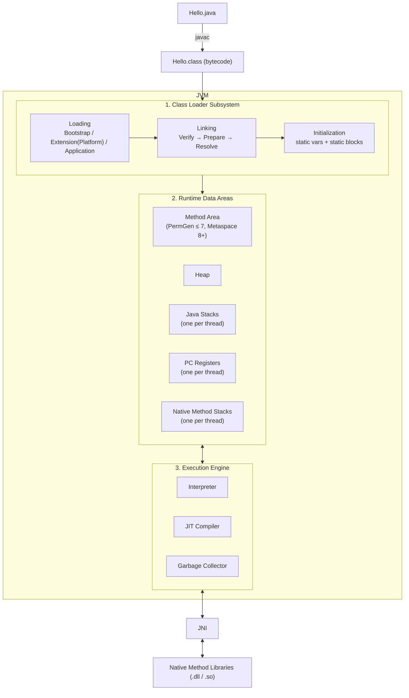
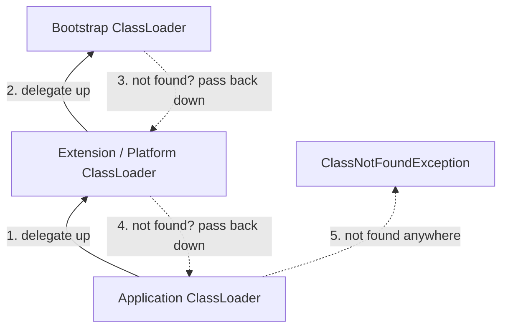
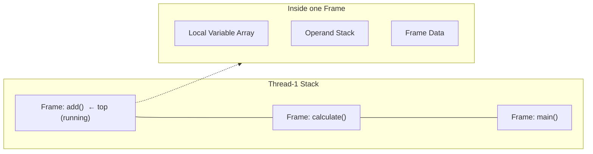
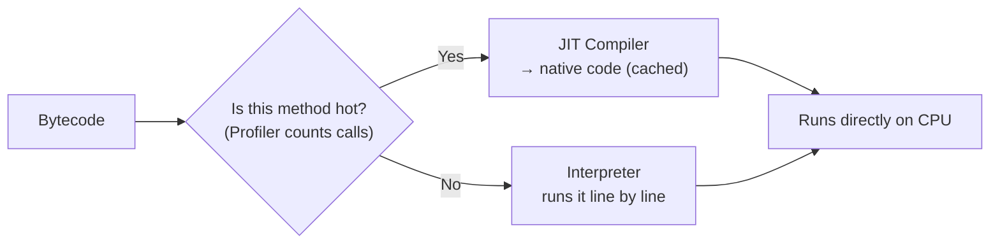

# JVM Architecture: From `.class` File to Execution

> [!info] Source
> Based on **"JVM (Java Virtual Machine) Architecture - tutorial"** by *Ranjith Ramachandran* (~29 min).
> The video walks through the JVM end to end: the class loader subsystem, the runtime data areas, the execution engine, and the **PermGen → Metaspace** change in JDK 8.
> Sections marked **💡 Extra** are my own additions on top of the video.

See also: [[JdkJreJvm]] for how the JDK, JRE and JVM fit inside each other.

---

## The Big Picture

A `.java` file is compiled by `javac` into a `.class` file holding **bytecode**. The JVM is the program that reads that bytecode and runs it on the real machine.

The JVM has **three main parts**:

1. **Class Loader Subsystem**: gets classes into memory (Load → Link → Initialize)
2. **Runtime Data Areas**: the memory the JVM uses while running
3. **Execution Engine**: actually runs the bytecode (Interpreter + JIT + GC)

It also talks to the OS through the **Java Native Interface (JNI)** and **native method libraries**.



---

## 1. Class Loader Subsystem

The class loader's job is to **find a `.class` file, load it, check it, and get it ready to run**. Classes are loaded **lazily**: the first time your code actually needs them, not all at startup.

It has three phases: **Loading → Linking → Initialization**.

### 1.1 Loading

Reads the `.class` file (from disk, a JAR, or the network) and creates a `java.lang.Class` object for it in the heap. The class's details (name, parent, methods, fields, constant pool) are stored in the **Method Area**.

There are three built-in class loaders, arranged as a hierarchy:

| Class Loader | Loads | Where from |
|---|---|---|
| **Bootstrap** | Core Java classes (`java.lang.*`, `java.util.*`, …) | `rt.jar` (JDK ≤ 8) / `java.base` module (JDK 9+) |
| **Extension** (renamed **Platform** in JDK 9+) | Extension classes | `jre/lib/ext` (JDK ≤ 8) / platform modules (9+) |
| **Application** (System) | Your classes | Classpath (`-cp`, `CLASSPATH`) |

Bootstrap is written in native code (C/C++), so `String.class.getClassLoader()` returns `null`.

#### Delegation Hierarchy Principle

When a class is requested, the class loader **asks its parent first**:



- Application asks Extension, Extension asks Bootstrap.
- If Bootstrap can't find it, it passes the job back down; each loader tries its own location.
- If nobody finds it → `ClassNotFoundException`.

**Why it works this way:** you can't replace core classes. If you write your own `java.lang.String`, Bootstrap loads the real one first and yours is never used. That's a security feature.

> [!tip] 💡 Extra: `ClassNotFoundException` vs `NoClassDefFoundError`
> - **`ClassNotFoundException`** (checked exception): you loaded a class *by name at runtime* (`Class.forName("com.x.Driver")`, `loadClass`) and it's not on the classpath.
> - **`NoClassDefFoundError`** (error): the class *was present at compile time* but is missing at runtime, or its static initialization failed earlier. Typical cause: a missing JAR in the deployed app, or a dependency version clash.
> In day-to-day work, both usually mean "check your classpath / dependency tree" (`mvn dependency:tree`).

> [!tip] 💡 Extra: Custom class loaders in real life
> You rarely write one, but you use them constantly: **Tomcat** gives each web app its own loader (so two apps can use different versions of the same library), **Spring Boot** has a `LaunchedURLClassLoader` for fat JARs, and **hot reload** tools (Spring DevTools, JRebel) work by throwing away a class loader and creating a new one. A classic **memory leak** is a class loader that can't be garbage-collected because something static still points at a class it loaded (common on app redeploys).

### 1.2 Linking

Linking has three steps: **Verify → Prepare → Resolve**.

#### a) Verification (Bytecode Verifier)

The **bytecode verifier** checks that the `.class` file is valid and safe before anything runs. It checks things like:

- The file format is correct (starts with the magic number `0xCAFEBABE`, version is supported).
- The bytecode doesn't break the stack (no underflow/overflow of the operand stack).
- Types are used correctly (you don't treat an `int` as an object reference).
- `final` classes are not extended and `final` methods are not overridden.
- Access rules (`private`, etc.) are respected.

If verification fails → **`java.lang.VerifyError`**.

**Why it's needed:** a `.class` file doesn't have to come from `javac`. It could be hand-edited or generated by a tool. Verification makes sure the JVM never runs bytecode that could crash it or get around Java's safety rules. This is a big reason Java is considered secure.

> [!tip] 💡 Extra
> - `UnsupportedClassVersionError` is related: the class was compiled with a newer JDK than the one running it (e.g. compiled on 21, run on 17). Class file major versions: Java 8 = 52, 11 = 55, 17 = 61, 21 = 65, 25 = 69.
> - Verification is the reason bytecode-manipulation libraries (ByteBuddy, ASM, CGLIB, used by Spring proxies, Hibernate and Mockito) must generate *correct* bytecode, or you'll see `VerifyError` at runtime.

#### b) Preparation

Memory is allocated for **static variables**, and they get their **default values** (not your values yet):

```java
static int count = 10;      // after Preparation: 0
static boolean flag = true; // after Preparation: false
static String name = "abc"; // after Preparation: null
```

The real values (`10`, `true`, `"abc"`) are assigned later, in Initialization.

> [!note] 💡 Extra
> `static final` compile-time constants (e.g. `static final int MAX = 10;`) are an exception: they're baked into the class file's constant pool and set directly.

#### c) Resolution

Replaces **symbolic references** with **direct references**.

In the bytecode, a class refers to other classes, methods and fields by **name** (e.g. `"java/lang/String"`). Resolution turns these names into real memory addresses/pointers in the Method Area. If something can't be resolved you get errors like `NoSuchMethodError` or `NoSuchFieldError`.

> [!tip] 💡 Extra
> `NoSuchMethodError` in production is almost always a **dependency version mismatch**: your code was compiled against version X of a library, but version Y (without that method) is on the runtime classpath.

### 1.3 Initialization

The final phase of class loading:

- Static variables get their **real values**.
- **`static` blocks** run, top to bottom in source order.
- The parent class is initialized before the child.

```java
class Config {
    static int count = 10;          // assigned now
    static {
        System.out.println("Config class initialized");
    }
}
```

> [!tip] 💡 Extra: When does initialization happen?
> Only on **first active use**: creating an object (`new`), calling a static method, reading/writing a non-constant static field, using reflection (`Class.forName`), or initializing a subclass. This is why the **holder idiom** for a lazy singleton is thread-safe with no locking:
> ```java
> class Singleton {
>     private Singleton() {}
>     private static class Holder { static final Singleton INSTANCE = new Singleton(); }
>     static Singleton getInstance() { return Holder.INSTANCE; } // Holder initialized here, once
> }
> ```
> If a static block throws, you get `ExceptionInInitializerError` the first time, and `NoClassDefFoundError` on every later attempt. That's confusing when debugging, so always look for the *first* error in the logs.

---

## 2. Runtime Data Areas (JVM Memory)

These are the memory areas the JVM uses while your program runs. Some are **shared by all threads**, others are **one per thread**.

| Area | Per thread or shared? | Stores | Error when full |
|---|---|---|---|
| **Method Area** | Shared (1 per JVM) | Class-level data: class structure, method bytecode, constant pool, static variables | `OutOfMemoryError: PermGen space` / `Metaspace` |
| **Heap** | Shared (1 per JVM) | All objects and arrays (`new …`) | `OutOfMemoryError: Java heap space` |
| **Java Stack** | Per thread | One **stack frame** per method call | `StackOverflowError` |
| **PC Register** | Per thread | Address of the current instruction being run | — |
| **Native Method Stack** | Per thread | Info for native (C/C++) method calls | `StackOverflowError` / `OutOfMemoryError` |

### 2.1 Method Area

- One per JVM, shared by all threads.
- Holds **class-level** data: class name, parent class, method and field info, method bytecode, the **runtime constant pool**, and static variables.
- Because it's shared, it's **not thread-safe**. Static variables are shared state, so be careful.

#### PermGen vs Metaspace (JDK 8 change)

| | **PermGen** (JDK ≤ 7) | **Metaspace** (JDK 8+) |
|---|---|---|
| Location | Part of the JVM's heap memory | **Native memory** (outside the heap) |
| Default size | Fixed, small (~64 MB on many setups) | Grows automatically (limited only by available OS memory) |
| Tuning flags | `-XX:PermSize`, `-XX:MaxPermSize` | `-XX:MetaspaceSize`, `-XX:MaxMetaspaceSize` |
| Typical error | `OutOfMemoryError: PermGen space` | `OutOfMemoryError: Metaspace` |

**Why the change:** PermGen had a fixed size, so apps that load lots of classes (app servers, frameworks generating proxy classes, frequent redeploys) kept running out of it. Metaspace grows as needed.

> [!warning] 💡 Extra
> "Grows automatically" doesn't mean "can't leak". A class loader leak in JDK 8+ just becomes a Metaspace leak that slowly uses up the machine's memory. In containers (Docker/Kubernetes), **set `-XX:MaxMetaspaceSize`** so a leak fails clearly instead of the container getting OOM-killed. Also, in JDK 7+ **string literals (the String pool) and static variables moved to the heap**; they don't live in PermGen/Metaspace.

### 2.2 Heap

- One per JVM, shared by all threads.
- Every object and array lives here: `new Employee()`, `new int[10]`, etc.
- Instance variables live inside their object on the heap.
- Managed by the **Garbage Collector**.
- Size set with **`-Xms`** (starting size) and **`-Xmx`** (max size).

```
-Xms512m -Xmx2g
```

> [!tip] 💡 Extra: Heap generations
> The heap is split into generations because most objects die young:
> - **Young Generation**: Eden + two Survivor spaces (S0, S1). New objects are created in Eden. **Minor GC** is frequent and fast.
> - **Old (Tenured) Generation**: objects that survive several minor GCs get promoted here. **Major/Full GC** is slower.
>
> In production, set `-Xms` equal to `-Xmx` to avoid resize pauses, and add `-XX:+HeapDumpOnOutOfMemoryError -XX:HeapDumpPath=/dumps` so you have a heap dump to analyse (Eclipse MAT, VisualVM) when things break. In containers, use `-XX:MaxRAMPercentage=75` instead of a hard-coded `-Xmx`.

### 2.3 Java Stack (one per thread)

- Every thread gets its own stack, created when the thread starts.
- Each **method call pushes a stack frame**; when the method returns, its frame is popped.
- Since each thread has its own stack, data on it is **thread-safe**.

Each **stack frame** has three parts:

1. **Local Variable Array**: method parameters and local variables (`this` at index 0 for instance methods).
2. **Operand Stack**: a work area for intermediate calculations. Bytecode instructions push and pop values here (e.g. `iload_1`, `iload_2`, `iadd`).
3. **Frame Data**: references to the constant pool, info needed to return normally, and the exception table for `catch` blocks.



Too deep a recursion (no base case) → too many frames → **`StackOverflowError`**. Stack size per thread is set with **`-Xss`** (e.g. `-Xss1m`).

> [!tip] 💡 Extra: Where do variables live?
> ```java
> void process() {
>     int x = 5;                    // x (the value 5) → stack
>     Employee e = new Employee();  // the reference 'e' → stack; the Employee object → heap
> }
> ```
> **Local variables live on the stack, objects live on the heap, static variables are class-level** (heap in JDK 8+, tied to the class). This ties in with [[LocalVsInstanceVariables]].
> To see the operand stack instructions yourself: `javap -c -v MyClass.class`.

### 2.4 PC Register (Program Counter)

- One per thread.
- Holds the **address of the bytecode instruction the thread is currently running**. Once it finishes, it points to the next one.
- This is how each thread knows where it left off when the CPU switches between threads.
- For a **native method**, its value is undefined.

### 2.5 Native Method Stack

- One per thread.
- Used when Java calls **native methods** (C/C++ code via JNI), e.g. `Thread.start()`, `System.currentTimeMillis()`, `Object.hashCode()`.
- In HotSpot, the Java stack and native stack are actually combined.

---

## 3. Execution Engine

The execution engine **reads the bytecode from the runtime data areas and runs it**, instruction by instruction. It has three parts.

### 3.1 Interpreter

- Reads and runs bytecode **one instruction at a time**.
- **Pro:** starts running straight away; no waiting for compilation.
- **Con:** slow for code that runs many times. If a method is called 1,000 times, it's interpreted 1,000 times.

### 3.2 JIT (Just-In-Time) Compiler

Fixes the interpreter's weakness:

- The **Profiler** watches which methods/loops run often (**"hot spots"**, which is where the name **HotSpot JVM** comes from).
- Once a method is called enough times, the JIT **compiles it into native machine code** and caches it.
- Future calls run the native code directly, which is much faster.

Main parts of the JIT:

1. **Intermediate Code Generator**: produces intermediate code
2. **Code Optimizer**: optimizes it
3. **Target Code Generator**: produces native machine code
4. **Profiler**: finds the hot spots



> [!tip] 💡 Extra: Tiered compilation and "warm-up"
> Modern HotSpot uses **tiered compilation**: **C1** (client compiler) compiles quickly with light optimization; **C2** (server compiler) compiles the hottest code with heavy optimizations, such as **method inlining**, **escape analysis** (objects that never leave a method may never be put on the heap at all), loop unrolling, and dead code removal.
>
> Effects you'll actually see:
> - **JVM warm-up:** the first requests to a freshly started service are slower. That's why load tests should discard the first minutes, and why some teams send "warm-up" traffic before putting a pod into rotation.
> - **Micro-benchmarks lie** unless you use **JMH**, because the JIT can optimize away code whose result you don't use.
> - Faster startup options: **CDS / AppCDS** (class data sharing), **GraalVM Native Image** (compiles everything ahead of time; used by Spring Boot native, Quarkus, Micronaut), and **Project Leyden / AOT cache** in recent JDKs.

### 3.3 Garbage Collector

- Runs in the background (a daemon thread) and **frees heap memory used by objects that nothing refers to anymore**.
- You can *request* GC with `System.gc()`, but the JVM **doesn't have to** do it.
- Basic idea: **Mark** (find live objects, starting from GC roots), **Sweep** (free the dead ones), and often **Compact** (pack survivors together).

> [!tip] 💡 Extra: Collectors you'll meet
> | Collector | Flag | When to use |
> |---|---|---|
> | Serial | `-XX:+UseSerialGC` | Tiny heaps, single CPU |
> | Parallel | `-XX:+UseParallelGC` | Batch jobs; throughput matters more than pauses |
> | **G1** (default since JDK 9) | `-XX:+UseG1GC` | General-purpose services |
> | **ZGC** (generational since JDK 21) | `-XX:+UseZGC` | Large heaps, very low pause times |
> | Shenandoah | `-XX:+UseShenandoahGC` | Low pause times (Red Hat builds) |
>
> **GC roots** = local variables on thread stacks, static fields, active threads, JNI references. An object reachable from a root is alive. **Memory leaks in Java** are objects that are still reachable but no longer needed, e.g. an ever-growing static `Map` cache, unremoved listeners, or `ThreadLocal`s in thread pools that are never cleared.
> Turn on GC logging in production: `-Xlog:gc*:file=gc.log:time,uptime`.

---

## 4. JNI and Native Method Libraries

- **JNI (Java Native Interface)**: the bridge that lets Java call native code (C/C++) and lets native code call back into Java.
- **Native Method Libraries**: the native libraries the execution engine needs (`.dll` on Windows, `.so` on Linux, `.dylib` on macOS).
- Methods marked with the `native` keyword are implemented here, e.g. `public static native long currentTimeMillis();`

> [!note] 💡 Extra
> JDK 22+ adds the **Foreign Function & Memory API** (Project Panama, `java.lang.foreign`), a safer and simpler modern alternative to writing JNI code.

---

## 5. Putting It All Together: Life of `java Hello`

```java
public class Hello {
    static String greeting = "Hello";           // static → initialized during class Initialization

    public static void main(String[] args) {    // main() frame pushed on main thread's stack
        Hello h = new Hello();                  // 'h' on stack, Hello object on heap
        System.out.println(h.say("JVM"));       // say() frame pushed, then popped
    }

    String say(String name) {
        return greeting + " " + name;
    }
}
```

1. `javac Hello.java` → `Hello.class` (bytecode).
2. `java Hello` starts the JVM.
3. **Loading:** the Application class loader (after delegating to its parents) loads `Hello`. Bootstrap loads `String`, `System`, `Object`, etc.
4. **Linking:** the verifier checks `Hello.class` → `greeting` is set to `null` (Prepare) → references to `String`/`System` are resolved.
5. **Initialization:** `greeting = "Hello"`.
6. The main thread gets its **stack**, **PC register** and **native stack**; a frame for `main()` is pushed.
7. `new Hello()` → object created on the **heap**; reference `h` is stored in the `main()` frame.
8. The **interpreter** runs the bytecode; if `say()` were called thousands of times, the **JIT** would compile it to native code.
9. `println` eventually calls native code through **JNI** to write to the console.
10. When `main()` returns, its frame is popped; the `Hello` object has no references left, so the **GC** can reclaim it. The JVM exits.

---

## 6. Interview Quick Revision

- JVM = **Class Loader** + **Runtime Data Areas** + **Execution Engine**.
- Class loading = **Load → Link (Verify, Prepare, Resolve) → Initialize**.
- Class loaders: **Bootstrap → Extension/Platform → Application**, with **parent-first delegation**.
- **Verify** = bytecode is valid and safe (`VerifyError`). **Prepare** = default values for statics. **Resolve** = symbolic names → direct references.
- **Shared:** Method Area, Heap. **Per thread:** Stack, PC Register, Native Method Stack.
- **PermGen (≤ 7, fixed size, in heap)** → **Metaspace (8+, native memory, grows)**.
- `StackOverflowError` = stack too deep. `OutOfMemoryError` = heap / metaspace full.
- **Interpreter** = quick start, slow repetition. **JIT** = compiles hot code to native.
- GC frees objects that are unreachable from GC roots; `System.gc()` is only a request.

### 💡 Extra: JVM flags cheat sheet

| Flag | Purpose |
|---|---|
| `-Xms` / `-Xmx` | Initial / max heap |
| `-Xss` | Stack size per thread |
| `-XX:MaxMetaspaceSize` | Cap Metaspace |
| `-XX:MaxRAMPercentage` | Heap as % of container memory |
| `-XX:+HeapDumpOnOutOfMemoryError` | Heap dump on OOM |
| `-Xlog:gc*` | GC logging (JDK 9+) |
| `-verbose:class` | Print every class as it's loaded (great for class loading issues) |
| `-XX:+PrintCompilation` | See what the JIT compiles |

### 💡 Extra: Tools for looking inside a running JVM

- `jps`: list running Java processes
- `jcmd <pid> GC.heap_info`, `jcmd <pid> Thread.print`, `jcmd <pid> VM.flags`
- `jstack <pid>`: thread dump (deadlocks, stuck threads)
- `jmap -dump:live,format=b,file=heap.hprof <pid>`: heap dump
- `jstat -gc <pid> 1s`: live GC stats
- **VisualVM**, **JDK Mission Control + Java Flight Recorder** (`-XX:StartFlightRecording`): low-overhead profiling in production
