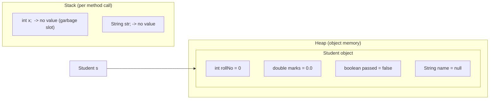

# Local Variables vs Instance Variables in Java

Java treats unassigned variables very differently depending on **where** they are declared.

* **Instance variables** (declared inside a class, outside any method) automatically get **default values**.
* **Local variables** (declared inside a method, constructor or block) get **no default value**. Reading one before assigning it is a **compile-time error**.

> **Note:** The error for local variables comes from the **compiler (`javac`)**, not the JVM. The code never becomes a `.class` file, so the JVM never runs it. The default values for instance variables are set at runtime, when `new` allocates the object on the Heap and the JVM zeroes that memory.



---

## 1. Instance Variables: Default Values

When an object is created with `new`, every field that isn't explicitly assigned gets a default value.

| Data Type | Default Value |
| :--- | :--- |
| `byte`, `short`, `int` | `0` |
| `long` | `0L` |
| `float` | `0.0f` |
| `double` | `0.0` |
| `char` | `'\u0000'` (null character, prints as blank) |
| `boolean` | `false` |
| Any reference (`String`, arrays, objects) | `null` |

```java
class Student {
    int rollNo;      // 0
    String name;     // null
}

Student s = new Student();
System.out.println(s.rollNo); // 0
System.out.println(s.name);   // null
```

**Static variables** follow the same rules and are set to defaults when the class is loaded.

### Exception: `final` instance variables

A `final` field gets **no** default value. It must be assigned exactly once, either at declaration, in an instance initializer block, or in **every** constructor.

```java
class Student {
    final int id;   // never assigned
}
// error: variable id not initialized in the default constructor
```

---

## 2. Local Variables: No Default Values

Local variables live in the method's stack frame. Java does not initialize them, and the compiler enforces **definite assignment**: every path to a read must assign the variable first.

```java
public static void main(String[] args) {
    int x;
    System.out.println(x);
}
```

```
error: variable x might not have been initialized
        System.out.println(x);
                           ^
```

### Key points

* **Declaring without reading is fine.** The error only appears when the variable is used.
  ```java
  int x;       // OK
  x = 10;      // OK
  System.out.println(x); // OK: prints 10
  ```
* **Every code path must assign it.** The compiler doesn't evaluate runtime conditions.
  ```java
  int y;
  if (args.length > 0) {
      y = 5;
  }
  System.out.println(y); // error: variable y might not have been initialized
  ```
  Adding an `else` branch that also assigns `y` fixes it.
* **Local references are no exception.** An unassigned local `String` is not `null`; it has no value at all.
  ```java
  String str;
  str.length(); // compile error, NOT a NullPointerException
  ```

---

## 3. Why the Difference?

* **Local variables:** An uninitialized local is almost always a programmer mistake, and the compiler can check it cheaply because the variable's whole lifetime is inside one method. Forcing an explicit value catches bugs early.
* **Instance variables:** Fields can be assigned by constructors, setters or other methods in any order, so the compiler can't prove when they're assigned. Instead, the JVM guarantees safe defaults by zeroing the object's memory on allocation.

---

## 4. Compile-Time vs Runtime Errors

| Situation | Result | When |
| :--- | :--- | :--- |
| Read an unassigned local variable | `variable x might not have been initialized` | Compile time |
| `final` field never assigned | `variable id not initialized in the default constructor` | Compile time |
| Call a method on a `null` instance variable (`s.name.length()`) | `NullPointerException` | Runtime |
| Read an unassigned instance variable | No error, default value is used | — |

---

## Summary Comparison

| Feature | Instance Variable | Local Variable |
| :--- | :--- | :--- |
| **Declared in** | Class body, outside methods | Method, constructor or block |
| **Stored in** | Heap (inside the object) | Stack (method's frame) |
| **Default value** | Yes (`0`, `false`, `null`, ...) | No |
| **Unassigned read** | Uses the default value | Compile-time error |
| **Lifetime** | As long as the object exists | Until the method/block finishes |
| **Access modifiers** | Allowed (`private`, `public`, ...) | Not allowed (only `final`) |
| **Scope** | Whole class (via `this`) | Only the enclosing block |

See [LocalVsInstanceVariables.java](LocalVsInstanceVariables.java) for runnable examples.

## Code Example

The example prints the default values of every kind of field and shows (in comments) which local-variable reads fail to compile.

```embed-java
PATH: "vault://src/main/java/com/personal/BasicClassAndObjectConcepts/LocalVsInstanceVariables.java"
```

## Output

Verified on Java 25 (the brackets after `grade` contain the invisible `'\u0000'` character):

```
rollNo  = 0
marks   = 0.0
passed  = false
grade   = [ ]  (int value: 0)
name    = null
scores  = null
count   = 0
id      = 101
x       = 10
z       = 0
```

## Access Modifiers (fields and methods)

| Modifier | Same class | Same package | Subclass (other package) | Everywhere |
|---|---|---|---|---|
| `private` | Yes | No | No | No |
| (default, no keyword) | Yes | Yes | No | No |
| `protected` | Yes | Yes | Yes | No |
| `public` | Yes | Yes | Yes | Yes |

## Day-to-Day Points for Experienced Developers

* **Constructors and chaining:** with no constructor written, the compiler adds a no-arg one; **once you write any constructor, that default disappears.** `this(...)` calls another constructor of the same class, `super(...)` the parent's; if you write neither, `super()` is inserted implicitly. Java 25 (JEP 513) allows statements that don't touch `this` before `super(...)`, e.g. argument validation.
  ```java
  class Point {
      final int x, y;
      Point() { this(0, 0); }                         // chains to the main constructor
      Point(int x, int y) { this.x = x; this.y = y; } // 'this.' resolves field vs parameter
  }
  ```
* **`static` vs instance:** a `static` field has one copy per class (like `count` here), an instance field one copy per object. Static methods have no `this`. Mutable `static` fields are effectively global state: a thread-safety and testability red flag in code review.
* **Don't rely on default values as business values.** A field silently defaulting to `0` or `null` hides a missing assignment that a local variable would have caught at compile time. Prefer `final` fields assigned in the constructor so the compiler enforces initialization.
* **The `equals` / `hashCode` contract:** override both or neither; equal objects must have equal hash codes, or `HashMap`/`HashSet` lose your objects. Never mutate fields used in `hashCode` while the object is a map key.
  ```java
  @Override public boolean equals(Object o) {
      return o instanceof Point p && x == p.x && y == p.y;   // pattern matching, Java 16+
  }
  @Override public int hashCode() { return Objects.hash(x, y); }
  ```
* **Records (Java 16+)** generate the constructor, accessors, `equals`, `hashCode` and `toString`. Ideal for DTOs and value objects; validate in a compact constructor:
  ```java
  record Point(int x, int y) {
      Point { if (x < 0) throw new IllegalArgumentException("x < 0"); }
  }
  ```
* **Immutability recipe:** `final` class, `private final` fields, no setters, defensive copies of mutable inputs and outputs (`List.copyOf(list)`). Immutable objects are thread-safe and safe as map keys (`String`, `Integer`, `LocalDate`).
* **Java is always pass-by-value.** For objects the value is a copy of the reference: a method can mutate the object, but reassigning the parameter does not affect the caller.
  ```java
  void change(StringBuilder sb) { sb.append("!"); sb = new StringBuilder("new"); }
  // the caller sees the "!" but still holds its original object
  ```
* **Every class inherits `Object`'s methods:** `toString` defaults to `ClassName@hexHash` (override it for useful logs), `clone` needs `Cloneable` and is best replaced by copy constructors, and `finalize` is deprecated for removal; use `try-with-resources` or `Cleaner`.

## Related
* [[SameMethodMultiClass]]
* [[JdkJreJvm]]
