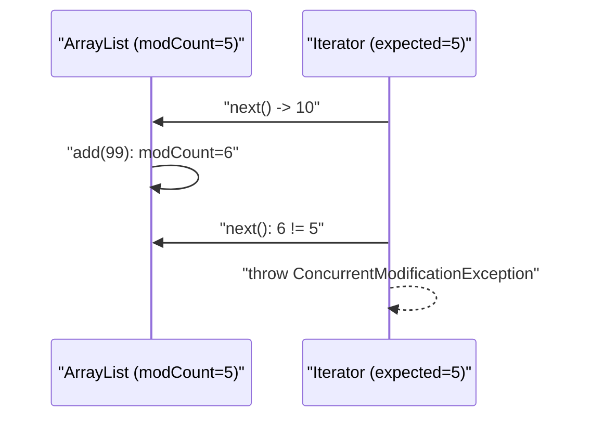

# Fail-Fast vs Fail-Safe Iterators in Java

When a collection is structurally modified while it is being iterated, a **fail-fast** iterator detects it and throws `ConcurrentModificationException`, while a **fail-safe** (snapshot or weakly consistent) iterator keeps going without an exception.

## Key Features
* **Structural modification:** any change to the collection's size, such as `add` or `remove`. `set(i, e)` is **not** structural and does not trip a fail-fast iterator (verified).
* **Fail-fast iterators** (`ArrayList`, `HashMap`, `HashSet` and the other `java.util` collections) record `modCount` when created. On each `next()` they compare it with the current value and throw `ConcurrentModificationException` (CME), a **runtime** exception, if the collection changed.
* **Fail-safe / weakly consistent iterators** (`java.util.concurrent` collections) never throw CME:
  * `CopyOnWriteArrayList` copies its whole array on every write. Its iterator walks the **snapshot** taken when it was created, so it never sees the new `100`s, even though they really are added to the list.
  * `ConcurrentHashMap` iterators are *weakly consistent*: they may or may not show changes made during iteration.
* **Index-based `for` loop with `add`:** no exception, but `size()` grows on every pass, so the loop never ends (until `OutOfMemoryError`).



## Code Example

The example prints an `ArrayList` with an index loop, then modifies it inside an `Iterator` loop (fail-fast), and finally does the same with a `CopyOnWriteArrayList` (fail-safe).

```embed-java
PATH: "vault://src/main/java/com/personal/CollectionsConcepts/FailSafeVsFailFastEx1.java"
```

## Output

The program **throws** at the first fail-fast `next()` after the `add`:
```
10
20
30
40
50
10
Exception in thread "main" java.util.ConcurrentModificationException
	at java.base/java.util.ArrayList$Itr.checkForComodification(ArrayList.java:1096)
	at java.base/java.util.ArrayList$Itr.next(ArrayList.java:1050)
	at com.personal.CollectionsConcepts.FailSafeVsFailFastEx1.main(FailSafeVsFailFastEx1.java:40)
```
Because the CME is uncaught, the **fail-safe section never runs**. Run on its own, the `CopyOnWriteArrayList` loop prints `100`, `200`, `300`, and afterwards the list is `[100, 200, 300, 100, 100, 100]` (verified). The final index-based loop over `cal` (L65-70) would then never terminate.

## Comparison

| | Fail-fast | Fail-safe / weakly consistent |
|---|---|---|
| Examples | `ArrayList`, `HashMap`, `HashSet` | `CopyOnWriteArrayList`, `ConcurrentHashMap` |
| Modified during iteration | Throws `ConcurrentModificationException` | No exception |
| Sees changes? | N/A (it throws) | COW: no (snapshot). CHM: maybe |
| `iterator.remove()` | Supported | COW: `UnsupportedOperationException`; CHM: supported |
| Cost | None | COW copies the array on every write |

## Day-to-Day Points for Experienced Developers
* **CME is a bug detector, not a concurrency guarantee:** fail-fast is "best effort" and most often fires in **single-threaded** code that modifies inside a loop. Across threads, an unsynchronized `ArrayList`/`HashMap` can corrupt silently without any CME.
* **Fix the loop, do not swallow the exception:** use `iterator.remove()`, `removeIf`, `replaceAll`, or collect changes into a separate list and apply them after the loop. Catching CME is a code-review red flag.
* **Maps have the same trap:** adding a *new* key inside `for (k : map.keySet())` throws CME (verified), while `put` on an *existing* key is not structural and is fine. Use `map.replaceAll(...)`, `computeIfPresent`, or `entrySet().removeIf(...)`.
* **Choose concurrent collections by access pattern:**
  * `ConcurrentHashMap` (and `ConcurrentHashMap.newKeySet()` for a set) for general shared maps/sets; it rejects `null` keys and values.
  * `CopyOnWriteArrayList` only for read-heavy, write-rare data such as listener lists; each write is O(N) and allocates a new array.
  * `ConcurrentLinkedQueue` / `BlockingQueue` implementations for producer-consumer.
* **`CopyOnWriteArrayList` iterators are read-only:** `it.remove()` throws `UnsupportedOperationException` (verified); use `cal.removeIf(...)` instead.
* **`Collections.synchronizedList` is still fail-fast:** individual calls are locked, but iteration must be wrapped manually: `synchronized (list) { for (var x : list) ... }`.
* **Weakly consistent means non-deterministic:** a `ConcurrentHashMap` loop that inserts keys may visit some of the new keys and not others, so never write logic that depends on whether new entries are seen.

## Corrections / Notes on the Code
1. **~L28-34:** the iterator does not "solve" modification during the loop. It **detects** it and fails fast. The fix is `itr.remove()` or `removeIf`, or collecting the changes and applying them after the loop.
2. **~L41:** `ConcurrentModificationException` is a **runtime** exception, not a compiler error. Because it is uncaught, the program ends there and the whole fail-safe section (L48-70) never executes. The stack trace points at L40 (`itr.next()`), the call that detects the change.
3. **~L62:** the extra `100`s **are** added to `cal`. They do not appear in that loop's output because the `CopyOnWriteArrayList` iterator walks a snapshot taken when it was created, not because CME is suppressed.

## Related
[[IteratorEx1]] · [[ArrayListCollectionEx1]]
