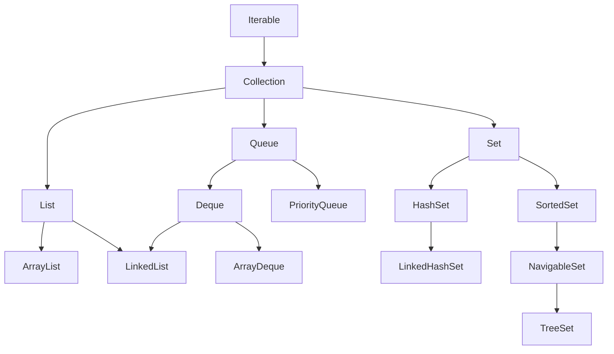

# Iterator in Java

An `Iterator` is a cursor that walks a collection one element at a time. Every `Collection` is `Iterable`, so every collection can hand out an `iterator()`, and the enhanced `for` loop is built on top of it.

## Key Features
* **`iterator()`:** returns a cursor over the collection. `hasNext()` checks whether another element exists; `next()` returns it and moves forward (and throws `NoSuchElementException` when exhausted).
* **`itr.remove()`:** the only safe way to remove the current element while iterating. Calling it twice without a `next()` in between throws `IllegalStateException`.
* **`descendingIterator()`:** walks from tail to head. It exists on `Deque` implementations (`LinkedList`, `ArrayDeque`) and on `NavigableSet` (`TreeSet`).
* **`ListIterator`:** only for `List`s. It moves both ways (`hasPrevious()`, `previous()`), can start at an index with `listIterator(i)`, and supports `set()` and `add()` during iteration.
* **The enhanced `for` loop uses an `Iterator` internally:** `for (Object o : list)` compiles to `iterator()`/`hasNext()`/`next()`.



## Code Example

The example walks a `LinkedList` with an explicit `Iterator` and also obtains (but never uses) a `descendingIterator()`.

```embed-java
PATH: "vault://src/main/java/com/personal/CollectionsConcepts/IteratorEx1.java"
```

## Output
```
12
123
1234
12345
```
(`ditr` is created but never used, so it prints nothing.)

## Day-to-Day Points for Experienced Developers
* **Prefer `removeIf` over manual iterator removal:**
  ```java
  list.removeIf(x -> x % 2 == 0);                        // Java 8+, one pass, O(N) on ArrayList
  Iterator<Integer> it = list.iterator();
  while (it.hasNext()) if (it.next() < 0) it.remove();   // also safe
  ```
  On an `ArrayList`, repeated `it.remove()` is O(N) per call (shift), so bulk removal with `removeIf` is much faster.
* **The silent for-each bug:** `list.remove(x)` inside a for-each usually throws `ConcurrentModificationException`, but if the removed element is the **second-to-last**, `hasNext()` becomes `false` and the loop ends silently (verified: removing `3` from `[1, 2, 3, 4]` gives `[1, 2, 4]` and `4` is never visited). Tests that pass on one input can hide this.
* **Iterate maps through `entrySet()`:** `for (var e : map.entrySet())` avoids a second lookup per key that `keySet()` + `get(k)` costs. `map.forEach((k, v) -> ...)` is equally fine.
* **Reverse iteration in Java 21+:** `list.reversed()`, `deque.reversed()`, `linkedHashSet.reversed()` give a reversed *view* usable in a for-each, replacing `descendingIterator()` and `ListIterator` tricks.
* **Do not call `next()` twice per `hasNext()`:** `if (it.next() != null) use(it.next())` skips elements and can throw `NoSuchElementException`; store the value in a local.
* **`Iterator` is single-use and not thread-safe:** do not share one across threads or cache it in a field; ask the collection for a fresh one. For lazy, possibly parallel pipelines use `stream()` / `spliterator()` instead.
* **Implementing `Iterable` on your own types** lets callers use for-each; returning `List.copyOf(items).iterator()` or `Collections.unmodifiableList(items).iterator()` prevents callers from mutating your internals through `remove()`.

## Corrections / Notes on the Code
1. **~L34:** besides `Deque` implementations, `descendingIterator()` also exists on `NavigableSet` (for example `TreeSet`; verified `new TreeSet<>(List.of(3,1,2))` descends as `3 2 1`).
2. **Minor:** the variable `lhs1` is a `LinkedList`, not a `LinkedHashSet`, and the `LinkedHashSet` import (L4) is unused.

## Related
[[FailSafeVsFailFastEx1]] · [[LinkedListCollectionEx1]] · [[TreeSetEx1]]
