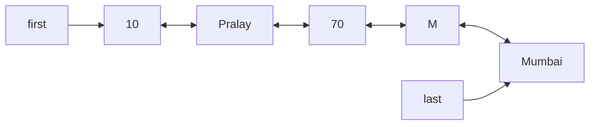

# LinkedList in Java

`LinkedList` is a **doubly linked list** that implements both `List` and `Deque`. It keeps insertion order, allows `null` and duplicates, and is O(1) at both ends but O(N) for anything addressed by index.

## Key Features
* **Node-based storage:** each element sits in its own `Node(prev, item, next)`, so nodes are scattered in memory rather than stored side by side.
* **O(1) at the ends:** `addFirst`, `addLast`, `removeFirst`, `removeLast`, `peekFirst`, and so on.
* **Index operations are O(N):** `get(6)`, `add(2, 70)` and `addAll(1, ll2)` first walk to the index. Java starts from whichever end is closer (`index < size/2`), but it is still linear.
* **`addAll(index, c)` is O(index + M):** it calls `c.toArray()` and links M new nodes at the position; any `Collection` (here an `ArrayList`) works as the source.
* **Heterogeneous data, nulls and duplicates are allowed. Insertion order is kept.**



## Code Example

The example builds a mixed-type `LinkedList`, inserts at an index, splices in another `LinkedList` and an `ArrayList` with `addAll(index, c)`, then reads by index.

```embed-java
PATH: "vault://src/main/java/com/personal/CollectionsConcepts/LinkedListCollectionEx1.java"
```

## Output
```
[10, Pralay, M, Mumbai]
[10, Pralay, 70, M, Mumbai]
[10, hehehe, ioioio, pppppp, Pralay, 70, M, Mumbai]
[10, hehehe, ioioio, Checking hetero, Why not homo, pppppp, Pralay, 70, M, Mumbai]
Pralay
```

## Day-to-Day Points for Experienced Developers
* **It is rarely the right choice:** "O(1) insert in the middle" only holds once you already hold a position (via a `ListIterator`). Finding the position is O(N) pointer chasing with poor cache locality, so `ArrayList` usually wins even for middle inserts at realistic sizes. (See the table in [[ArrayListCollectionEx1]].)
* **Never loop with `get(i)`:** `for (int i = 0; i < ll.size(); i++) ll.get(i)` is O(N^2). Use for-each or an iterator. Indexed loops over a `List` parameter of unknown type are a review red flag (`RandomAccess` marks the lists where they are cheap).
* **Use `ListIterator` for in-place edits:** it inserts or replaces at the cursor in O(1).
  ```java
  var it = ll.listIterator();
  while (it.hasNext()) { int x = it.next(); if (x == 2) it.add(99); if (x == 3) it.set(33); }
  // [1, 2, 3, 4] -> [1, 2, 99, 33, 4]  (verified)
  ```
* **For queues and stacks prefer `ArrayDeque`:** less memory (no node object per element) and faster. Reasons to keep `LinkedList` as a `Deque` are needing `null` elements or `ListIterator` edits.
* **Mind the null-vs-exception pairs:** `poll()`/`peekFirst()` return `null` on empty, while `getFirst()`/`removeFirst()`/`element()` throw `NoSuchElementException`. Because `LinkedList` allows `null` elements, a `null` from `poll()` is ambiguous; check `isEmpty()` instead.
* **Declare by role:** `Deque<Task> q = new LinkedList<>()` or `List<T> l = ...`, so switching to `ArrayDeque`/`ArrayList` later is a one-line change.
* **GC cost:** every element is an extra object, so large `LinkedList`s add allocation and GC pressure that often shows up only when profiling.

## Corrections / Notes on the Code
1. **~L23:** insertion/deletion "at any given position" is O(1) only at the ends (or at an iterator's cursor); at an arbitrary index it is O(N) because of the walk.
2. **~L56-57:** `addAll(index, c)` copies `c` into an array and links M new nodes; the cost is O(index + M) (walk to the position, then link), not O(N + M).

## Related
[[ArrayListCollectionEx1]] · [[ArrayDequeEx1]] · [[IteratorEx1]]
