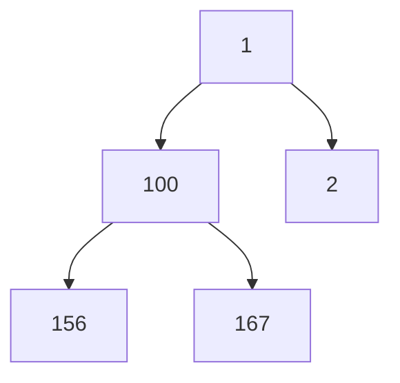

# PriorityQueue in Java

`PriorityQueue` is an unbounded queue that always hands out the smallest element first (by natural order or a supplied `Comparator`). Internally it is a binary min-heap stored in an array.

## Key Features
* **Binary min-heap in an array:** `peek()` is O(1); `offer`/`add` and `poll` are O(log N).
* **Hierarchy:** `PriorityQueue` extends `AbstractQueue`, which implements `Queue`.
* **`toString()` and iteration show the heap array, not sorted order:** `[1, 100, 2, 156, 167]` only guarantees that the smallest element is first. Repeated `poll()` gives sorted order: `1 2 100 156 167` (verified).
* **Max-heap:** `new PriorityQueue<>(Comparator.reverseOrder())`.
* **No `null`s** (`NullPointerException`). Elements must be mutually comparable, otherwise `ClassCastException` during sift-up.


Heap array `[1, 100, 2, 156, 167]`: each parent is smaller than its children, but siblings are not ordered.

## Code Example

The example adds integers to a raw `PriorityQueue`, prints the heap array, then adds a `String`.

```embed-java
PATH: "vault://src/main/java/com/personal/CollectionsConcepts/PriorityQueueEx1.java"
```

## Output

The program prints the heap and then **throws** on line 43:
```
[1, 100, 2, 156, 167]
Exception in thread "main" java.lang.ClassCastException: class java.lang.Integer cannot be cast to class java.lang.String (java.lang.Integer and java.lang.String are in module java.base of loader 'bootstrap')
	at java.base/java.lang.String.compareTo(String.java:144)
	at java.base/java.util.PriorityQueue.siftUpComparable(PriorityQueue.java:647)
	at java.base/java.util.PriorityQueue.siftUp(PriorityQueue.java:639)
	at java.base/java.util.PriorityQueue.offer(PriorityQueue.java:330)
	at java.base/java.util.PriorityQueue.add(PriorityQueue.java:311)
	at com.personal.CollectionsConcepts.PriorityQueueEx1.main(PriorityQueueEx1.java:43)
```
During sift-up the new `"Pralay"` is compared with an existing `Integer`; `String.compareTo` tries to cast that `Integer` to `String` and fails. Generics (`PriorityQueue<Integer>`) would reject this at compile time.

## Comparison

| | `ArrayDeque` | `LinkedList` | `PriorityQueue` |
|---|---|---|---|
| Structure | Circular array | Doubly linked list | Binary min-heap |
| Order | FIFO/LIFO (both ends) | FIFO/LIFO (both ends) | By priority |
| `null` | Not allowed | Allowed | Not allowed |
| Head operations | O(1) | O(1) | `peek` O(1), `poll` O(log N) |

`Queue` method pairs:

| | Throws exception | Returns `null`/`false` |
|---|---|---|
| Insert | `add(e)` | `offer(e)` |
| Remove head | `remove()` | `poll()` |
| Examine head | `element()` | `peek()` |

## Day-to-Day Points for Experienced Developers
* **Never print or iterate a `PriorityQueue` expecting sorted order:** use `poll()` in a loop, or `pq.stream().sorted().toList()` for a non-destructive sorted view. Logging `pq.toString()` while debugging is a common source of confusion.
* **Top-K with a bounded min-heap:** keep K elements and drop the smallest when it grows past K, giving O(N log K).
  ```java
  var top = new PriorityQueue<Integer>();
  for (int x : data) { top.offer(x); if (top.size() > k) top.poll(); }
  // data {5,1,9,3,7,8}, k=3 -> heap holds 7, 8, 9  (verified)
  ```
* **Ties are not FIFO:** the heap is not stable; equal-priority items come out in arbitrary order (verified: four tasks with priorities 1,1,0,1 inserted as a,b,c,d polled as `c d a b`). Add a tie-breaker such as a sequence number: `comparingInt(Task::priority).thenComparingLong(Task::seq)`.
* **Build comparators, do not subtract:** `(a, b) -> a.p - b.p` overflows for large values; use `Comparator.comparingInt(Task::p)` or `Integer.compare`.
* **`contains` and `remove(Object)` are O(N):** there is no index. To "change a priority", remove and re-insert (O(N)), or use lazy deletion (mark stale entries and skip them on `poll`). Mutating an element's priority field in place corrupts the heap.
* **Bulk construction is O(N):** `new PriorityQueue<>(collection)` heapifies in linear time, cheaper than N separate `offer` calls.
* **Not thread-safe:** for producer-consumer scheduling use `PriorityBlockingQueue` (blocking `take()`), or `DelayQueue` for time-based work; a plain `PriorityQueue` shared between threads can corrupt its heap.

## Corrections / Notes on the Code
1. **~L16-18:** "front/middle insertion" is not a concept here: the insertion position is decided by the heap, not by the caller.
2. **~L44:** the exception comes from `pq.add("Pralay")` on **line 43**, not from the `println` on L44.
3. **~L53:** the saved stack trace says `PriorityQueueEx1.java:31`, which is out of date; the current run reports line 43.

## Related
[[ArrayDequeEx1]] · [[TreeSetEx1]] · [[LinkedListCollectionEx1]]
