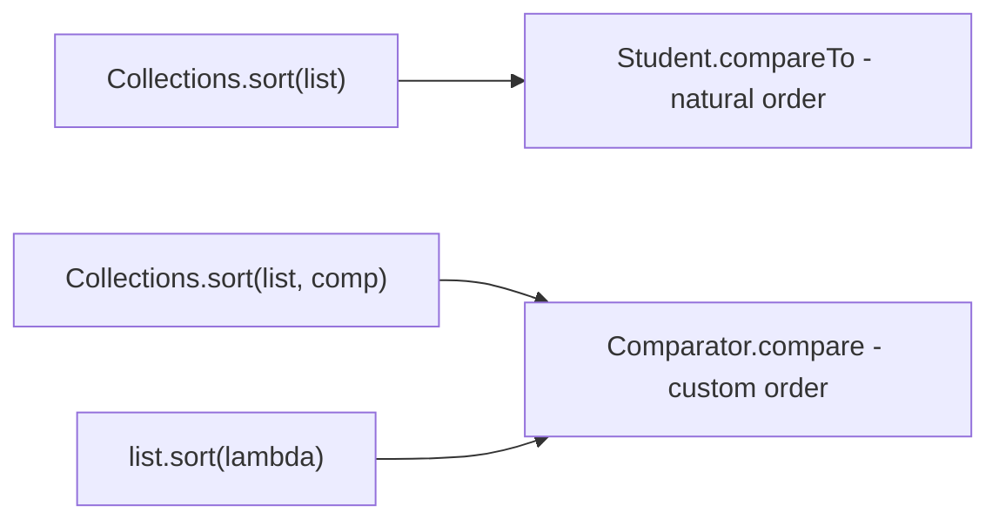

# Comparable Interface in Java

`Comparable<T>` lets a class define its own *natural ordering* through a single method, `compareTo`. Once a class implements it, `Collections.sort(list)`, `TreeSet`, `TreeMap` and friends can order its objects with no extra arguments.

## Key Features
* **Natural ordering:** `Comparable<T>` (in `java.lang`) has one method, `int compareTo(T o)`. The class itself decides how it sorts.
* **Return value contract:** negative means `this` comes before `o`, zero means equal in order, positive means `this` comes after `o`.
* **Ascending vs descending:** `this.age - o.age` sorts ascending; swapping operands (`o.age - this.age`) sorts descending.
* **Requires source access:** you must modify the class to implement `Comparable`, so you cannot add it to third-party / JDK classes. That is where `Comparator` comes in.
* **Who else uses it:** `TreeSet`, `TreeMap`, `Arrays.sort`, `Collections.max/min`, `Stream.sorted()` use natural ordering when no comparator is given. `String`, `Integer`, `LocalDate` etc. already implement it.
* **Stable sort:** `Collections.sort` (TimSort) keeps equal elements in their original relative order.



## Code Example

`Student implements Comparable<Student>` with `compareTo` by age; the list is printed before and after `Collections.sort(nums)`.

```embed-java
PATH: "vault://src/main/java/com/personal/ComparatorComparableConcepts/ComparableInterfaceEx1.java"
```

## Output
```
[Student [age= 26 name= Pralay ], Student [age= 29 name= Payal ], Student [age= 28 name= Raj ], Student [age= 27 name= Abhijeet ]]
[Student [age= 26 name= Pralay ], Student [age= 27 name= Abhijeet ], Student [age= 28 name= Raj ], Student [age= 29 name= Payal ]]
```

## Day-to-Day Points for Experienced Developers
* **Subtraction comparisons can overflow:** `a - b` gives the wrong sign when values are far apart (`Integer.MIN_VALUE - 5` is positive, verified). Use `Integer.compare` / `Long.compare` / `Double.compare`:
  ```java
  public int compareTo(Student o) { return Integer.compare(this.age, o.age); }
  ```
* **Keep `compareTo` consistent with `equals`:** `TreeSet`/`TreeMap` treat `compareTo == 0` as a duplicate. Ordering students only by age silently drops a second student of the same age from a `TreeSet`. Add tie-breakers.
* **JDK gotcha, `BigDecimal`:** `new BigDecimal("1.0").equals(new BigDecimal("1.00"))` is `false` but `compareTo` is `0`, so a `HashSet` holds 2 of them and a `TreeSet` holds 1 (verified). Compare money with `compareTo`, never `equals`.
* **Records + natural order:** `record Student(String name, int age) implements Comparable<Student>` gives `equals`/`hashCode`/`toString` for free; implement `compareTo` via `Comparator.comparingInt(Student::age).thenComparing(Student::name)` held in a `static final` field.
* **Implement natural ordering only when there is one obvious order** (dates, versions, IDs). For business-specific orders ("by salary", "by name"), use a `Comparator` instead of baking it into the class.
* **Sorting immutable lists fails:** `List.of(...)` and `Stream.toList()` results throw `UnsupportedOperationException` on `sort`. Copy first: `new ArrayList<>(list)`.
* **Missing `Comparable`:** `Collections.sort(list)` on a generic list of a non-`Comparable` type does not compile; with raw types, or `TreeSet.add`, it fails at runtime with `ClassCastException`.
* **Strings sort case-sensitively:** `String.compareTo` puts uppercase before lowercase. Use `String.CASE_INSENSITIVE_ORDER` or a `Collator` for user-facing, locale-aware sorting.

## Corrections / Notes on the Code
* **~line 68:** "But Student does not extends the Comparable interface" is outdated. `Student` *does* implement `Comparable<Student>` (line 6), which is exactly why `Collections.sort(nums)` works. Also, classes *implement* interfaces; `extends` is for class-to-class or interface-to-interface.
* **~line 22:** `this.age - o.age` is fine for small ages but is an overflow-prone pattern in general; prefer `Integer.compare`.
* **~line 30:** "compareTo will default to ascending order only" is misleading: the order depends entirely on what you return; `Collections.sort` simply places elements so that `compareTo` results are non-decreasing.

## Related
[[ComparatorEx1]]
