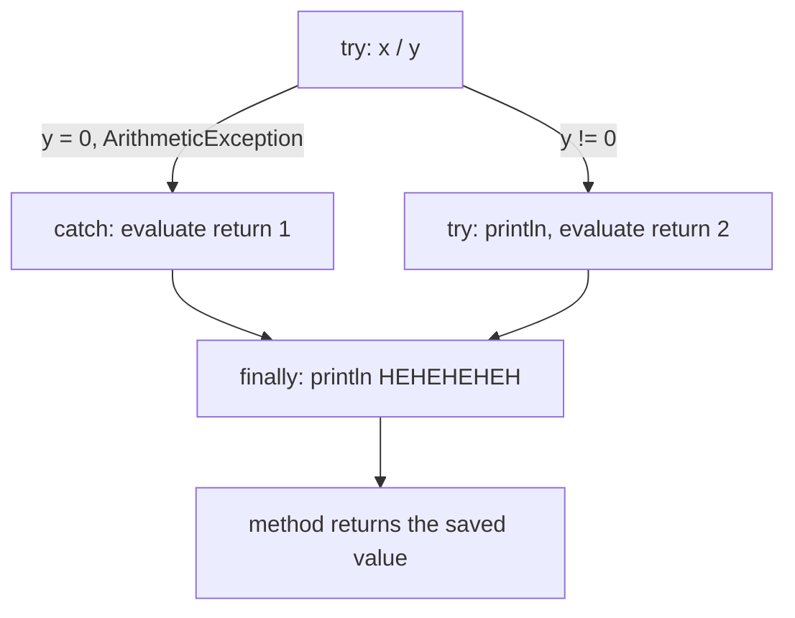

# return and finally in Java

When `try` or `catch` contains a `return`, the `finally` block still runs - **after** the return value has been evaluated but **before** control goes back to the caller. Whether `finally` changes the result depends on whether it contains its own `return`.

## Key Features
* **finally runs before the method actually returns:** The return value is computed first, then `finally` executes, then the caller receives the value.
* **Exception skips the rest of try:** With `y = 0`, the `println` and `return 2` are never reached; `catch` returns `1`.
* **finally does not change the return value here:** It only prints. It would override the value only if it contained its own `return` (or `throw`).
* **Return value is captured, not re-read:** Reassigning a returned local variable inside `finally` has no effect on a primitive result (see snippet below).

## How It Works



Verified edge cases:
```java
static int f() { try { return 2; } finally { return 3; } }          // returns 3 (override - bad practice)
static int g() { int x = 1; try { return x; } finally { x = 99; } } // returns 1 (value already captured)
```

## Code Example

`Example.check()` divides `100` by `0` inside a `try` that returns `2`, has a `catch` that returns `1`, and a `finally` that only prints.

```embed-java
PATH: "vault://src/main/java/com/personal/ExceptionConcepts/ExceptionReturnExample.java"
```

## Output

With `y = 0` (as in the code):
```
HEHEHEHEH
1
```

## Comparison: final vs finally vs finalize

| Keyword | What it is |
|---|---|
| `final` | Modifier: variable cannot be reassigned, method cannot be overridden, class cannot be extended |
| `finally` | Block that runs after `try`/`catch` regardless of outcome (except `System.exit`, `Runtime.halt`, JVM crash, or a `try` that never finishes) |
| `finalize()` | `Object` method once called by the GC before collection; deprecated for removal since Java 18 (JEP 421). Use `try-with-resources` or `java.lang.ref.Cleaner` |

## Day-to-Day Points for Experienced Developers
* **Never `return` or `throw` from `finally`:** It silently discards the exception or return value from `try`/`catch`. `javac -Xlint:finally` warns "finally clause cannot complete normally", and Sonar/IntelliJ flag it.
* **An exception inside `finally` masks the original:** If cleanup code in `finally` throws (e.g. `close()` fails), the original exception from `try` is lost. That is exactly the problem try-with-resources solves.
* **Prefer try-with-resources over `finally { close(); }`:** Any `AutoCloseable` is closed automatically in reverse order, and close failures are attached as suppressed exceptions instead of hiding the real one:
  ```java
  try (var in = Files.newBufferedReader(src);
       var out = Files.newBufferedWriter(dest)) {
      in.transferTo(out);
  } // both closed here, out first
  ```
* **Check `getSuppressed()` when debugging:** If the body throws `"body"` and `close()` throws `"close"`, you catch `"body"` and `e.getSuppressed()[0]` is `"close"` (verified). Loggers print them as `Suppressed:` blocks in the stack trace.
* **`finally` is not guaranteed on shutdown:** `System.exit()`, `Runtime.halt()`, `kill -9`, or a container OOM-kill skip it. For process-level cleanup use shutdown hooks (`Runtime.getRuntime().addShutdownHook`) or Spring's `@PreDestroy`, and design for crash-safety anyway.
* **Typical legitimate `finally` uses:** releasing a `Lock` (`lock.lock(); try { ... } finally { lock.unlock(); }`), clearing `ThreadLocal`/MDC values in pooled threads (`MDC.clear()`), and recording metrics/timers. Forgetting these leaks state into the next request on the same thread.
* **Don't touch `finalize()`:** It is deprecated for removal; replace with try-with-resources for deterministic cleanup or `Cleaner` as a safety net.

## Corrections / Notes on the Code
* **Line ~15:** The comment "finally will always override returns from try and catch" is not accurate. `finally` runs *before* the method returns, but it only overrides the value if `finally` itself contains a `return`. Here it only prints, so the method returns `1` (verified).
* **Line ~47:** The comment says `HEHEHEHEHE`, but the code prints `HEHEHEHEH`.

## Related
[[ExceptionExample1]] | [[NestedTryCatchEx]]
