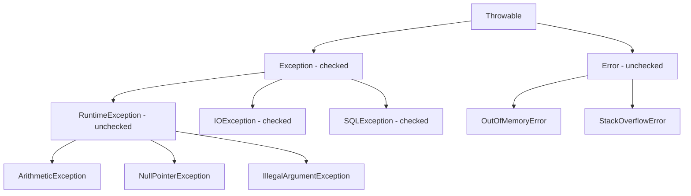

# Throwable, throw and throws in Java

`Throwable` is the root of every exception and error in Java; only instances of it (or its subclasses) can be used with `throw` and `catch`. The `throw` statement raises an exception object, while the `throws` clause in a signature declares which checked exceptions may escape the method.

## Key Features
* **`throw` vs `throws`:** `throw new Throwable(...)` raises an exception object; `throws Throwable` in the signature declares what may escape.
* **Throwable is checked:** Since it is not a `RuntimeException` or `Error`, callers must handle or declare it - that is why `main` declares `throws Throwable`.
* **Message and stack trace:** The constructor argument becomes `getMessage()`, and the stack trace is captured when the object is *created* (in `test()` at line 8).
* **Demo only:** In real code never throw or catch raw `Throwable`; throw a specific `Exception` subclass instead.

## Throwable Hierarchy



Rule of thumb: everything under `RuntimeException` and `Error` is **unchecked**; everything else under `Throwable` (including `Throwable` and `Exception` themselves) is **checked**.

## Code Example

`ThrowableEx1.test()` throws a raw `Throwable` when `y == 0`, and `main` propagates it with `throws Throwable`.

```embed-java
PATH: "vault://src/main/java/com/personal/ExceptionConcepts/ThrowableEx.java"
```

## Output

The program throws:
```
Exception in thread "main" java.lang.Throwable: Example Exception
	at com.personal.ExceptionConcepts.ThrowableEx1.test(ThrowableEx.java:8)
	at com.personal.ExceptionConcepts.ThrowableEx.main(ThrowableEx.java:17)
```

## Comparison: throw vs throws

| `throw` | `throws` |
|---|---|
| Statement inside a method body | Clause in a method/constructor signature |
| Followed by one exception **object** | Followed by one or more exception **types** |
| `throw new IllegalArgumentException("bad id");` | `void read() throws IOException, SQLException` |
| Actually raises the exception | Only declares it may escape |

## Day-to-Day Points for Experienced Developers
* **Don't catch `Throwable` or `Error`:** You would also catch `OutOfMemoryError` and `StackOverflowError`, after which the JVM may be in an inconsistent state. Catch `Exception` at most, and only at boundaries. If a top-level handler must catch `Throwable`, log and rethrow (or exit) rather than continue.
* **Fail fast with standard exceptions:** `Objects.requireNonNull(x, "x must not be null")`, `IllegalArgumentException`, `IllegalStateException` and `UnsupportedOperationException` cover most validation; reviewers recognise them instantly.
* **Helpful NullPointerExceptions (Java 14+, on by default):** Messages name the null expression, e.g. `Cannot invoke "String.length()" because "user.name" is null`. Local variable names only appear if classes were compiled with `-g` (Maven/Gradle do this by default); otherwise you see `"<local1>"` (verified).
* **Missing stack traces in production:** HotSpot's `OmitStackTraceInFastThrow` optimisation can make frequently thrown built-in exceptions (NPE, `ArithmeticException`, `ClassCastException`) appear with no message and no stack trace after many repeats. Search the logs for the *first* occurrence, or run with `-XX:-OmitStackTraceInFastThrow`.
* **Cheap exceptions when the trace is useless:** For high-volume, expected signals you can skip stack capture with the protected constructor `super(message, cause, false, false)` (no suppression, no writable stack trace). Use sparingly - you lose debuggability.
* **Pattern matching on exceptions (Java 16+):** Handle a wrapped cause cleanly instead of casting:
  ```java
  if (e.getCause() instanceof SQLException sql && sql.getSQLState().startsWith("23")) {
      throw new DuplicateKeyException("Already exists", e);
  }
  ```
* **`throw` accepts any expression of a `Throwable` type:** `throw null;` compiles and throws `NullPointerException`; a reused, pre-built exception instance keeps its *original* stack trace, which misleads debugging. Create exceptions at the throw site.

## Corrections / Notes on the Code
* **Lines ~4-8:** Fine for demonstrating that `Throwable` is checked, but `throw new Throwable(...)` should not appear in real code. The local `x` is unused.

## Related
[[CompileTimeExceptionEx]] | [[ParentChildOverridenExceptionex]] | [[ExceptionExample1]]
