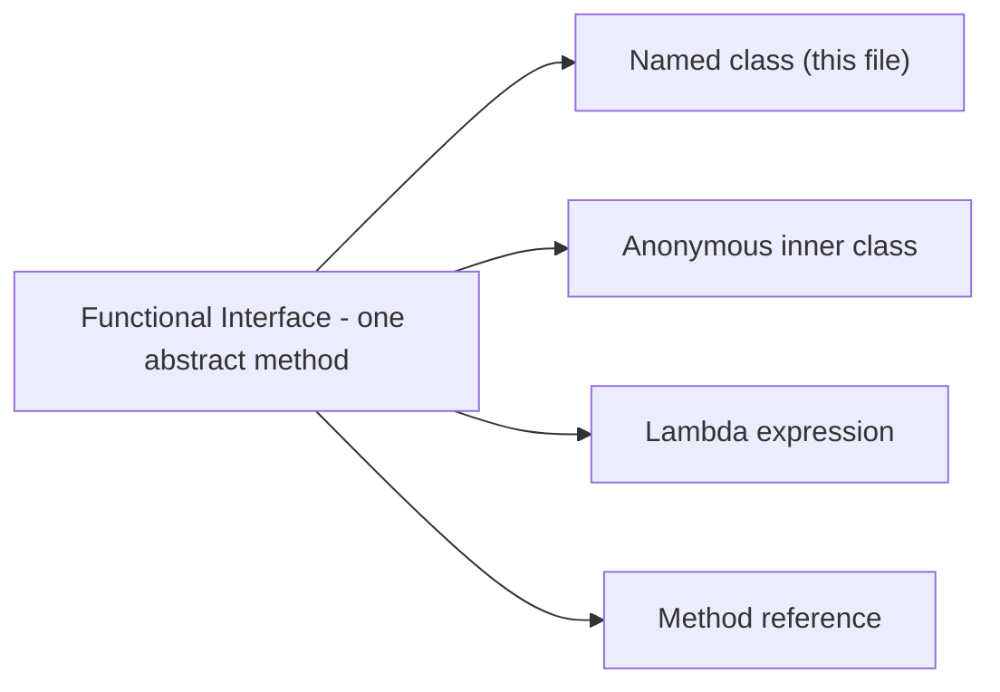

# Functional Interfaces in Java

A **functional interface** is an interface with exactly one abstract method (a SAM, Single Abstract Method, type). It is the target type for lambdas and method references, but it can also be implemented the classic way with a named class, as this file does.

## Key Features
* **Single Abstract Method:** Exactly one abstract method; any number of `default`, `static`, `private` methods and constants are allowed.
* **`@FunctionalInterface` is optional:** It does not make an interface functional; it makes the compiler **fail** if a second abstract method is added. Use it on interfaces meant for lambdas.
* **`Object` methods don't count:** Redeclaring `boolean equals(Object o)` or `String toString()` does not break the SAM rule (verified). That is why `Comparator` is functional despite declaring `equals`.
* **Polymorphic reference:** `IFunctionalInterfaceConcept1 test1 = new ChildClass();` calls `ChildClass`'s overridden method.
* **Running it:** `main` lives in the non-public class `StartHere`, so run `com.personal.FunctionalInterface.StartHere`.

## Ways to Implement a Functional Interface



## Code Example

This example declares a functional interface, implements it with `ChildClass`, and calls it through an interface reference.

```embed-java
PATH: "vault://src/main/java/com/personal/FunctionalInterface/IFunctionalInterfaceConcept1.java"
```

## Output

```
Hii there
```

## Comparison: Built-in Functional Interfaces (`java.util.function`)

Don't create your own SAM interface if one of these fits.

| Interface | Method | Shape | Example |
|---|---|---|---|
| `Function<T,R>` | `apply` | T -> R | `Function<String,Integer> len = String::length;` |
| `BiFunction<T,U,R>` | `apply` | (T,U) -> R | `(a, b) -> a + b` |
| `UnaryOperator<T>` | `apply` | T -> T | `String::toUpperCase` |
| `BinaryOperator<T>` | `apply` | (T,T) -> T | `Integer::sum` |
| `Predicate<T>` | `test` | T -> boolean | `s -> s.isEmpty()` |
| `Consumer<T>` | `accept` | T -> void | `System.out::println` |
| `Supplier<T>` | `get` | () -> T | `ArrayList::new` |
| `Runnable` | `run` | () -> void | `() -> doWork()` |
| `Callable<V>` | `call` | () -> V, may throw | `() -> fetch()` |

## Day-to-Day Points for Experienced Developers

* **Prefer the JDK types:** A custom SAM interface is worth it only when the name adds domain meaning (`PriceCalculator`) or you need checked exceptions.
* **Primitive specialisations avoid boxing:** `IntPredicate`, `ToIntFunction<T>`, `IntUnaryOperator`, `DoubleSupplier` matter in hot loops and large data sets.
* **Composition helpers:** with `inc = x -> x + 1` and `dbl = x -> x * 2`, `inc.andThen(dbl).apply(3)` is `8` while `inc.compose(dbl).apply(3)` is `7` (verified). Also `Predicate.and/or/negate`, `Predicate.not(String::isBlank)` (Java 11), `Function.identity()`.
* **Checked exceptions:** Built-in interfaces don't declare `throws`, so `paths.map(p -> Files.readString(p))` won't compile. Wrap and rethrow as `UncheckedIOException`, or define your own:
  ```java
  @FunctionalInterface
  interface ThrowingFunction<T, R> { R apply(T t) throws Exception; }
  ```
* **Ambiguous overloads:** `executor.submit(() -> work())` can match both `Runnable` and `Callable`; returning a value picks `Callable`. Avoid overloading your own methods on different functional interfaces of the same arity.
* **Always annotate public SAM interfaces:** `@FunctionalInterface` protects library consumers' lambdas from being broken by a future second abstract method.
* **Generic variance in parameters:** Accept `Function<? super T, ? extends R>` rather than `Function<T, R>` in APIs so callers can pass broader lambdas, as the JDK does.

## Corrections / Notes on the Code

* **~line 14:** "Lambda expressions (syntactic sugar for anonymous inner classes)" is a helpful mental model but not technically true. Lambdas create no class file at compile time (they are linked via `invokedynamic`), `this` means the enclosing instance, they don't introduce a new scope, and they can only target functional interfaces. See [[AnonymousInnerClassExampleInterface]] for the full comparison.
* **~line 8:** Besides constants and `default` methods, a functional interface may also have `static` and `private` methods, and redeclared `Object` methods such as `equals`.
* **`static void main()` with no `String[]` (~line 29):** valid only because of Java 25 instance main methods (JEP 512). On Java 21 or earlier this class would not be launchable.

## Related
[[IInterfaceConcepts1]] | [[AnonymousInnerClassExampleInterface]] | [[LambdaExpressionExample]]
