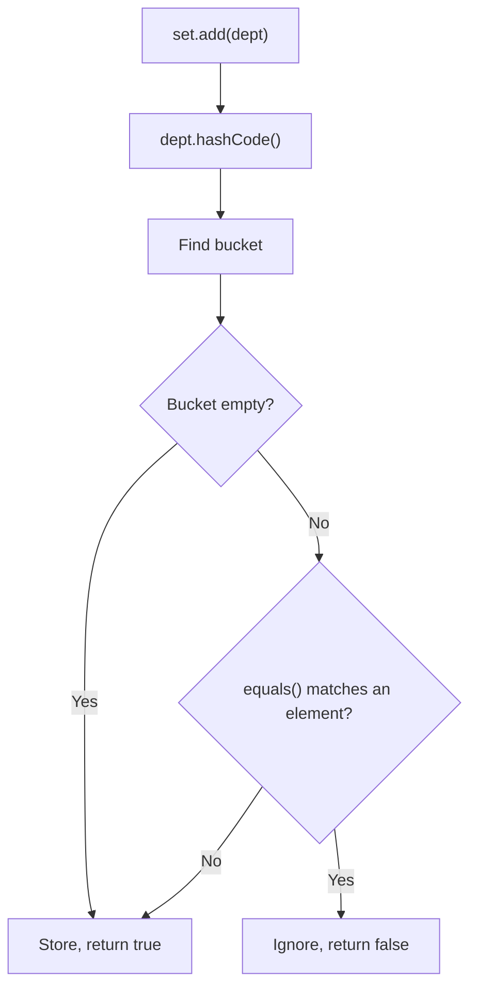

# equals() and hashCode() in a HashSet

A `HashSet` decides whether two objects are duplicates using `hashCode()` and `equals()`. If a class overrides both consistently, two different objects with the same logical value count as one element.

## Key Features
* **`HashSet` is backed by a `HashMap`:** `add(e)` calls `map.put(e, PRESENT)`. The element becomes the key and a shared dummy object is the value.
* **Two-step duplicate check:** `hashCode()` picks the bucket, then `equals()` compares against the elements already in that bucket.
* **Logical equality by `id`:** `Department` overrides both methods using only `id`, so `new Department(1, "Dev")` added twice gives one element.
* **The contract:** if `a.equals(b)` is `true`, then `a.hashCode() == b.hashCode()` must also be `true`. The reverse isn't required, because different objects can share a hash code (a collision).
* **Pattern matching for `instanceof`:** `obj instanceof Department fmtObj` checks the type and casts in one step (Java 16+).
* **Instance `main` method:** `static void main()` with no `String[] args` and no `public` is a valid entry point in Java 25 (JEP 512). Older JDKs reject it.

## How It Works



## Code Example

The example adds two `Department` objects with the same `id` to a `HashSet` and prints its size.

```embed-java
PATH: "vault://src/main/java/com/personal/Main.java"
```

## Output

```
1
```

## Day-to-Day Points for Experienced Developers
* **Use a `record` for value objects:** it generates `equals`, `hashCode` and `toString` from all components, so they can't drift apart when a field is added.
  ```java
  record Department(int id, String name) {}
  ```
* **Never mutate a field used in `hashCode()` while the object is in a `HashSet` or is a `HashMap` key.** The object stays in its old bucket: `contains()` returns `false` and `remove()` silently fails, which is a classic memory-leak and bug source.
* **JPA/Hibernate entities are a special case.** A generated `id` is `null` before persist, so `id`-based `hashCode()` changes after saving. Common approaches are a business key, or a constant `hashCode()` together with an `id`-based `equals()`.
* **`instanceof` vs `getClass()`:** `instanceof` lets a subclass equal its parent, which can break symmetry when the subclass adds fields. Make value classes `final`, or compare `getClass()`.
* **Use `Objects.equals(a, b)` and `Objects.hash(...)`** for null-safe comparisons. For hot paths, a hand-written `31 * h + field` avoids the varargs array that `Objects.hash` allocates.
* **Lombok `@Data`/`@EqualsAndHashCode`** includes all fields by default, including lazy JPA relations, which can trigger extra queries or infinite recursion. Choose fields explicitly with `@EqualsAndHashCode.Include`.
* **Test the contract:** a quick unit test asserting `assertEquals(a, b)` and `assertEquals(a.hashCode(), b.hashCode())` catches broken overrides. Libraries like EqualsVerifier automate this.

## Corrections / Notes on the Code
* **"my answer is 2" (~line 40):** the actual output is `1`. Both objects have `id = 1`, so `hashCode()` matches and `equals()` returns `true`, and the second `add()` is rejected. You'd get `2` only without the overrides, because `Object`'s versions compare identity.

## Related
[[JavaConcepts]] · [[LinkedHashSetAndHashSetEx1]] · [[HashMapEx1]]
