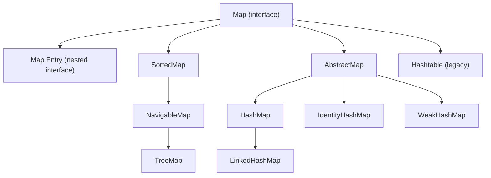

# HashMap and the Map Interface in Java

A `Map` stores data as key-value pairs, where each pair is a `Map.Entry`. `HashMap` is the default general-purpose implementation: hash-based, O(1) average `get`/`put`, with no ordering guarantee.

## Key Features
* **Not a Collection:** `Map` does not extend `Collection` or `Iterable`. You cannot for-each over a `Map` directly, only over one of its views.
* **`Map.Entry`:** A nested interface representing one key-value row. `javap` shows it as `java.util.Map$Entry` (the `$` marks a nested type).
* **Three views:** `keySet()` returns a `Set<K>`, `values()` a `Collection<V>`, `entrySet()` a `Set<Map.Entry<K,V>>`. These are *live views* backed by the map, not copies.
* **No ordering guarantee:** Iteration order depends on hash buckets, not insertion order.
* **One `null` key allowed:** Re-putting the same key (including `null`) replaces the value; `put` returns the old value.
* **Capacity / load factor:** Default capacity 16, load factor 0.75. The table doubles once the number of entries exceeds `capacity * loadFactor` (the 13th entry with defaults).



## Code Example

Creates a `HashMap`, prints it and its `keySet()`, then puts three values under the `null` key to show replacement.

```embed-java
PATH: "vault://src/main/java/com/personal/MapInterfaceConcepts/HashMapEx1.java"
```

## Output
```
{18=Kohli, 19=dravid, 10=Sachin}
[18, 19, 10]
```
`Integer.hashCode()` is the value itself, so 18 lands in bucket 2, 19 in bucket 3 and 10 in bucket 10 of a 16-slot table, which explains this order. Do not rely on it. `hm` ends up holding a single entry `{null=ABC}` (it is never printed).

## Comparison: HashMap vs LinkedHashMap vs TreeMap vs IdentityHashMap

| Feature | `HashMap` | `LinkedHashMap` | `TreeMap` | `IdentityHashMap` |
|---|---|---|---|---|
| Ordering | None | Insertion (or access) order | Sorted by key (natural or `Comparator`) | None |
| Key comparison | `hashCode()` + `equals()` | `hashCode()` + `equals()` | `compareTo()` / `compare()` | `==` + `identityHashCode()` |
| `null` key | One allowed | One allowed | Not allowed with natural ordering (NPE) | Allowed |
| `null` values | Allowed | Allowed | Allowed | Allowed |
| `get`/`put` | O(1) average | O(1) average | O(log n) | O(1) average |
| Internals | Array of buckets (list, treeified to red-black tree at 8+ entries) | `HashMap` + doubly linked list | Red-black tree | Linear-probing array |
| Typical use | Default choice | Ordered output, LRU caches | Range queries, sorted keys | Reference-identity tracking |

Thread-safe alternatives: `ConcurrentHashMap` (preferred), `ConcurrentSkipListMap` (sorted). `Hashtable` and `Collections.synchronizedMap` are legacy / coarse-locked.

## Day-to-Day Points for Experienced Developers
* **Use generics and program to the interface:** `Map<Integer, String> m = new HashMap<>();`. Raw `HashMap` (as in this file) loses type checking; `javac -Xlint` flags `[rawtypes]` and `[unchecked]` here.
* **Iterate with `entrySet()` or `forEach`**, not `keySet()` + `get()` (a second lookup per key):
  ```java
  for (Map.Entry<String, Integer> e : map.entrySet()) { e.getKey(); e.getValue(); }
  map.forEach((k, v) -> System.out.println(k + "=" + v));
  ```
* **Counting / grouping without boilerplate:**
  ```java
  counts.merge(word, 1, Integer::sum);                           // frequency
  groups.computeIfAbsent(dept, k -> new ArrayList<>()).add(emp); // multimap
  int n = counts.getOrDefault("x", 0);
  ```
* **`get()` returning `null` is ambiguous:** it means "absent" or "mapped to null". Use `containsKey()` when it matters. `ConcurrentHashMap` forbids `null` keys/values for exactly this reason.
* **`ConcurrentModificationException`:** removing from the map inside a for-each over its views fails fast (verified). Use `map.entrySet().removeIf(e -> e.getValue() == 0)` or `Iterator.remove()`.
* **Pre-size large maps:** since Java 19, `HashMap.newHashMap(expectedSize)` sizes the table so no resize happens. `new HashMap<>(n)` takes a *capacity*, not an expected size.
* **Not thread-safe:** concurrent `put`s can lose updates. Use `ConcurrentHashMap` with atomic `compute`/`merge` instead of check-then-act (`if (!m.containsKey(k)) m.put(k, v)`).
* **Interview staple:** since Java 8, a bucket with 8+ colliding entries (table size at least 64) becomes a red-black tree, so worst-case lookup is O(log n) instead of O(n).

## Corrections / Notes on the Code
* **~line 28-30:** `keySet()`/`values()`/`entrySet()` do not "convert" or copy the map. They return views backed by it: `map.keySet().remove(k)` removes the entry from the map (verified).
* **~line 45-46:** The return *type* is the `Set` interface, but the object is a concrete class (`java.util.HashMap$KeySet`, verified via `getClass()`). An interface itself is never instantiated.
* **~line 50-51:** Resizing happens when the entry count exceeds `capacity * 0.75` (more than 12 entries for capacity 16), not "when data increases by 75%".

## Related
[[IdentityHashMapAndHashMapEx2]] | [[LinkedHashMapEx1]]
