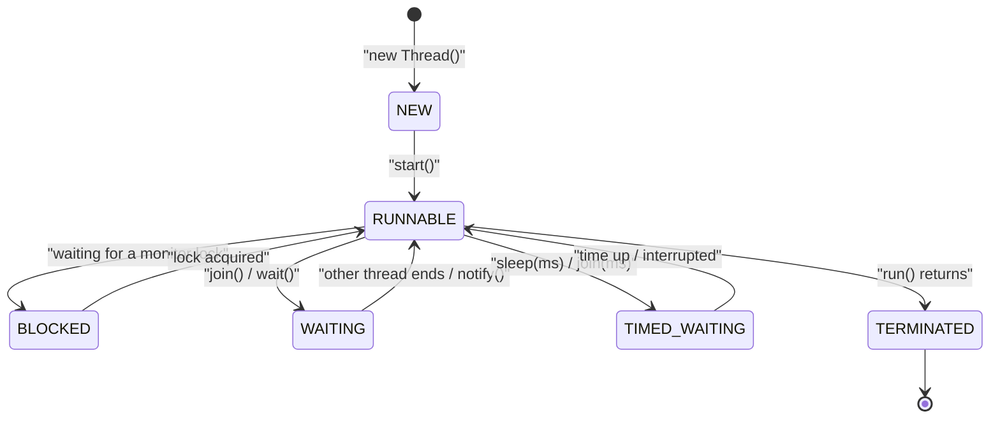

# The Main Thread in Java

A **thread** is an independent path of execution inside one JVM process. Every Java program starts on a thread named `main`, and `Thread.currentThread()` returns the thread that is running the current line of code.

## Key Features
* **`Thread.currentThread()`:** Returns a reference to the thread executing the current line. In `main()`, that is the `main` thread.
* **`toString()` format (Java 19+):** `Thread[#id,name,priority,group]`. Before Java 19 the ID was not shown (`Thread[main,5,main]`).
* **Thread ID:** Assigned by the JVM and unique while the thread is alive. On this JDK 25 run, `main` was `#3`. Read it with `threadId()` (Java 19+); `getId()` is deprecated.
* **Priority:** Ranges from `Thread.MIN_PRIORITY` (1) to `Thread.MAX_PRIORITY` (10). The default is `Thread.NORM_PRIORITY` (5). A new thread inherits the priority of the thread that created it.
* **Thread group:** `main` belongs to the `main` thread group. Thread groups are legacy and rarely used directly today.
* **Mutable name and priority:** `setName()` and `setPriority()` can change these at runtime, even for `main`.

## Thread Lifecycle (`Thread.State`)

Every thread, including `main`, moves through these states. `t.getState()` returns the current one.



* **No separate RUNNING state:** Java's `RUNNABLE` covers both "running on a CPU" and "ready to run". The OS scheduler decides which one.
* **`start()` only once:** Calling `start()` again on the same thread (even after it finishes) throws `IllegalThreadStateException` (verified).
* **BLOCKED vs TIMED_WAITING:** A thread sleeping inside a `synchronized` block shows `TIMED_WAITING`; another thread waiting for that same lock shows `BLOCKED` (verified).

## Code Example

This example prints the current (`main`) thread, then renames it and lowers its priority, and prints it again.

```embed-java
PATH: "vault://src/main/java/com/personal/Multithreading/MultithreadingEx1.java"
```

## Output

Verified on JDK 25:

```
Thread[#3,main,5,main]
Thread[#3,Pralay ka Thread,4,main]
```

This program is single-threaded, so the output is the same on every run. The ID (`#3`) can differ between JDK versions.

## Day-to-Day Points for Experienced Developers

* **Always name your threads:** Default names like `Thread-7` or `pool-3-thread-2` make logs and dumps hard to read. Pass a name, or use a builder/factory for pools.
  ```java
  new Thread(task, "order-worker-1").start();
  ThreadFactory f = Thread.ofPlatform().name("order-worker-", 0).factory();
  ExecutorService ex = Executors.newFixedThreadPool(4, f);
  ```
* **Thread dumps for debugging hangs:** `jstack <pid>` or `jcmd <pid> Thread.print` prints every thread's state and stack, and reports deadlocks ("Found one Java-level deadlock"). Use `jcmd <pid> Thread.dump_to_file -format=json out.json` to include virtual threads. Take 2-3 dumps a few seconds apart; a thread stuck on the same frame in all of them is your suspect.
* **Do not rely on priorities:** `setPriority()` is only a hint to the OS scheduler and is often ignored (on Linux it has no effect by default). Never use it to get ordering or correctness.
* **Virtual threads look different:** `Thread.ofVirtual().start(...)` prints as `VirtualThread[#39]/runnable`, has no name by default, always has priority 5, and is always a daemon. `Thread.currentThread()` returns the virtual thread, not the carrier.
* **`Thread.currentThread()` in pooled code:** In an `ExecutorService`, the thread is reused across tasks. Anything you attach to it (a renamed thread, a `ThreadLocal`, MDC log context) leaks into the next task unless you reset it in `finally`.
* **Uncaught exceptions kill only that thread:** An exception escaping `run()` ends that thread and is printed to stderr; `main` and others keep running. Set a handler so it is logged properly.
  ```java
  Thread.setDefaultUncaughtExceptionHandler((t, e) -> log.error("Thread {} died", t.getName(), e));
  ```
* **Daemon vs non-daemon:** `main` is non-daemon. The JVM exits only when all non-daemon threads have finished. `setDaemon(true)` must be called before `start()`.

## Corrections / Notes on the Code

* **~Lines 31-34 (why `main` isn't ID 1):** The comment says background system threads (GC, signals) take the first IDs. A JDK 25 check with `Thread.getAllStackTraces()` shows the opposite: `main` was `#3`, and the system threads came *after* it (`Reference Handler` `#15`, `Finalizer` `#16`, `Signal Dispatcher` `#17`). GC threads are native VM threads and have no Java thread ID at all. The low IDs are used up internally while the JVM boots, and the exact number depends on the JDK version, so do not rely on it.

## Related
[[MultithreadingEx2]] | [[MultithreadingRunnableEx3]] | [[MultithreadingJoinThreadEx1]] | [[SynchronizedEx1]]
