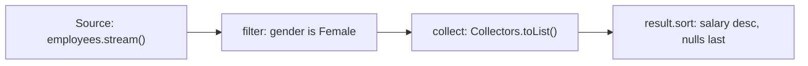

# Java Streams API: Filter and Null-Safe Sort

The **Streams API** (Java 8+) processes collections declaratively as a pipeline: a source, zero or more intermediate operations, and one terminal operation. This file filters a list of `Employee` objects with a stream, then sorts the result with a custom `Comparator` that handles `null` salaries.

## Key Features
* **Stream pipeline:** `source -> intermediate ops -> terminal op`. Here `employees.stream().filter(...).collect(Collectors.toList())`.
* **`filter(Predicate)`:** Keeps elements for which the lambda returns `true`; the source list `employees` is not modified.
* **Lazy evaluation:** `filter` does nothing until a terminal operation (`collect`) runs.
* **Comparator contract:** `compare(a, b)` returns negative if `a` sorts first, positive if `b` sorts first, `0` if they are equal.
* **Null-safe ordering:** The anonymous `Comparator` puts `null` salaries last and sorts the rest descending via `Double.compare(e2.salary, e1.salary)`. Swapping the arguments gives ascending.
* **Stable sort:** `List.sort` is stable, so employees with equal salaries (F and D, both `105030.0`) keep their original relative order.
* **Modern equivalent (commented in the file):** gives the same result as the hand-written comparator.
  ```java
  Comparator.comparing(Employee::getSalary,
          Comparator.nullsLast(Comparator.reverseOrder()))
  ```

## How It Works



## Code Example

This example builds seven employees, keeps only the female ones with a stream, and sorts them by salary descending with `null` salaries last.

```embed-java
PATH: "vault://src/main/java/com/personal/StreamConcepts/StreamConceptEx1.java"
```

## Output

```
[[ Employee name= A gender= Male salary= 102030.0 ], [ Employee name= B gender= Female salary= 104030.0 ], [ Employee name= C gender= Female salary= 100030.0 ], [ Employee name= F gender= Female salary= 105030.0 ], [ Employee name= E gender= Bigender salary= 202030.0 ], [ Employee name= D gender= Female salary= 105030.0 ], [ Employee name= G gender= Female salary= NULL ]]
[[ Employee name= F gender= Female salary= 105030.0 ], [ Employee name= D gender= Female salary= 105030.0 ], [ Employee name= B gender= Female salary= 104030.0 ], [ Employee name= C gender= Female salary= 100030.0 ], [ Employee name= G gender= Female salary= NULL ]]
```

## Comparison

### Intermediate vs Terminal Operations

| | Intermediate | Terminal |
|---|---|---|
| Returns | Another `Stream` | A result or side effect (`List`, `long`, `Optional`, `void`) |
| Runs when | Only when a terminal op is invoked (lazy) | Immediately; triggers the whole pipeline |
| Examples | `filter`, `map`, `flatMap`, `sorted`, `distinct`, `limit`, `skip`, `peek`, `mapMulti`, `gather` | `collect`, `toList`, `forEach`, `reduce`, `count`, `min`/`max`, `findFirst`, `anyMatch`, `allMatch` |
| Stateful? | `sorted`, `distinct` buffer elements; `filter`, `map` don't | - |
| Short-circuiting | `limit`, `takeWhile` | `findFirst`, `findAny`, `anyMatch`, `noneMatch` |

### Collecting to a List

| Call | Mutable? | Nulls allowed? | Notes |
|---|---|---|---|
| `collect(Collectors.toList())` | Not guaranteed (an `ArrayList` today, verified) | Yes | Spec makes no promise about type or mutability |
| `collect(Collectors.toCollection(ArrayList::new))` | Yes, guaranteed | Yes | Use when you will modify the result |
| `stream.toList()` (Java 16+) | No, unmodifiable | Yes (verified) | Preferred default in modern code |
| `collect(Collectors.toUnmodifiableList())` | No | No, throws NPE (verified) | |

## Day-to-Day Points for Experienced Developers

* **Streams can't be reused:** a second terminal op throws `IllegalStateException: stream has already been operated upon or closed` (verified). Re-call `list.stream()` or keep a `Supplier<Stream<T>>`.
* **`toMap` duplicate keys blow up:**
  ```java
  Stream.of("a", "bb", "cc").collect(Collectors.toMap(String::length, s -> s));
  // IllegalStateException: Duplicate key 2 (attempted merging values bb and cc)
  ```
  Pass a merge function `(a, b) -> a`, or use `groupingBy` if you want all values. `toMap` also throws NPE on a `null` value.
* **`groupingBy` for reports:** `employees.stream().collect(Collectors.groupingBy(Employee::getCity, Collectors.counting()))`; pass `TreeMap::new` as the map factory for sorted keys, or use `partitioningBy(pred)` for a true/false split.
* **Nothing runs without a terminal op:** `list.stream().peek(System.out::println).map(...)` prints nothing. Since Java 9, `count()` may skip the pipeline entirely when the size is known, so `peek` before `count()` printed nothing (verified). Use `peek` only for debugging.
* **Avoid side effects:** don't `forEach(e -> otherList.add(e))`; collect instead. Shared mutable state breaks under `parallel()`.
* **Optional pitfalls:** `findFirst()` returns `Optional`; never call `.get()` blindly. Use `orElse`, `orElseThrow()`, `ifPresent`, `map`. `orElse(expensive())` always evaluates its argument; use `orElseGet(() -> expensive())`. Don't use `Optional` for fields or parameters.
* **Nulls inside pipelines:** `Comparator.comparing(Employee::getSalary)` throws NPE on a `null` salary (verified); wrap with `nullsLast`/`nullsFirst`. `filter(Objects::nonNull)` is the usual guard.
* **Numeric streams avoid boxing:** `employees.stream().mapToDouble(Employee::getSalary).average()` returns `OptionalDouble`; `sum()` and `summaryStatistics()` are also available. With a `null` salary this NPEs on unboxing, so filter first.
* **`sorted` vs `List.sort`:** `stream().sorted()` produces a new ordering and leaves the source untouched; `list.sort()` mutates the list in place.
* **Multi-key sort:** `Comparator.comparing(Employee::getCity).thenComparing(Employee::getSalary, Comparator.reverseOrder())`.
* **Parallel streams are not a free speedup:** they use the common `ForkJoinPool`, have overhead for small lists, and blocking I/O inside them starves other tasks. Measure before using.
* **Newer stream tools:** `takeWhile`/`dropWhile` (Java 9), `mapMulti` (Java 16), `Collectors.teeing` (Java 12) to combine two collectors in one pass, and Stream Gatherers (`gather(Gatherers.windowFixed(2))`, final in Java 24) for custom intermediate ops such as windowing (all verified on Java 25).

## Corrections / Notes on the Code

* **~line 83, `emp.gender.equalsIgnoreCase("FEMALE")`:** NPEs if any employee has a `null` gender. The null-safe idiom is `"Female".equalsIgnoreCase(emp.getGender())`. Also prefer the getter over direct field access.
* **~lines 83 and 95, sorting the collected list:** `result.sort(...)` works because `Collectors.toList()` currently returns an `ArrayList`, but that is not guaranteed by the spec. If you switch to `stream.toList()`, `result.sort(...)` throws `UnsupportedOperationException` (verified). Sort inside the pipeline with `.sorted(...)` as the commented version does, or collect with `Collectors.toCollection(ArrayList::new)`.
* **~line 88 comment, "will be not swapped":** A comparator doesn't decide swaps; `0` means "equal". The original order is kept only because `List.sort` is a stable sort.
* **~line 15, constructor parameter `Double Salary`:** works, but Java convention is lowercase `salary` for parameters.
* **~line 63, `toString()`:** missing `@Override`, which would catch signature typos at compile time.
* **`static void main()` with no `String[]` (~line 71):** valid only on Java 25 (JEP 512, instance main methods).

## Related
[[LambdaExpressionExample]] | [[AnonymousInnerClassExampleInterface]] | [[IFunctionalInterfaceConcept1]]
