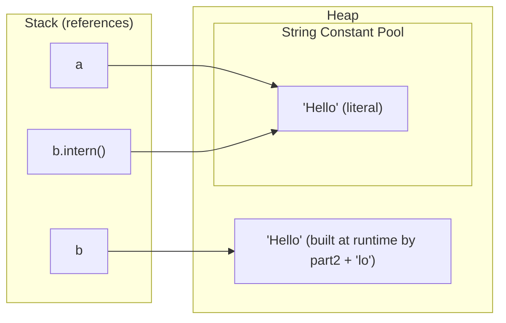

# String Pool, Constants and intern() in Java

`String` is an immutable class, and Java keeps string literals in a shared **String Constant Pool** on the heap. This example shows when two `String` references point to the **same object** and when they only hold the **same characters**.

## Key Features
* **Literals are pooled:** `"Hello"` written twice in source is stored only once in the pool, so `pt1 == pt2` is `true`.
* **Compile-time constant folding:** `"Hel" + "lo"` is joined by `javac`. The `.class` file holds just `"Hello"`, so `p == q` is `true`.
* **`final` variables can be constants:** `final String part1 = "Hel"` is a *constant variable*, so `part1 + "lo"` is also folded at compile time (`r == s` is `true`).
* **Runtime concatenation makes a new object:** `part2` is not `final`, so `part2 + "lo"` runs at runtime and creates a new `String` on the heap. `a == b` is `false`.
* **`intern()`:** returns the pooled copy of the string (adding it to the pool if it is not there yet). `a == b.intern()` is `true`.
* **`equals()` compares content:** `a.equals(b)` is `true`. Use it for every string comparison in real code.
* **`String.equals()` only matches another `String`:** `"Hello".equals(sb1)` is `false` because the argument is a `StringBuilder`. To compare with any `CharSequence`, use `"Hello".contentEquals(sb1)`, which returns `true`.

## How It Works



## Code Example

The example compares pooled literals, compile-time constants and runtime-built strings with `==`, `intern()` and `equals()`.

```embed-java
PATH: "vault://src/main/java/com/personal/StringConcepts/StringConcepts.java"
```

## Output

Verified on Java 25:

```
true
true
true
false
true
true
true
false
false
```

## Comparison

### `==` vs `equals()` vs `contentEquals()`

| Check | Compares | `"Hello"` vs runtime-built `"Hello"` | `"Hello"` vs `StringBuilder("Hello")` |
|---|---|---|---|
| `==` | References (memory address) | `false` | Does not compile (incomparable types) |
| `equals()` | Content, but argument must be a `String` | `true` | `false` |
| `contentEquals()` | Content of any `CharSequence` | `true` | `true` |
| `equalsIgnoreCase()` | Content, ignoring case | `true` | Not applicable |

## Day-to-Day Points for Experienced Developers

* **Never compare strings with `==` in real code.** It may pass in tests (literals are pooled) and then fail with input from users, files or the network. Put the literal first to avoid an NPE: `"ADMIN".equals(role)`, or use `Objects.equals(a, b)` when both sides can be `null`.
* **Immutability means methods return new strings.** `s.toUpperCase();` on its own line does nothing; write `s = s.toUpperCase();`. Static analysis flags ignored return values of `String` methods for this reason.
* **Avoid calling `intern()` by hand** in application code. Interning lots of dynamic strings fills the pool. The JVM already deduplicates literals, and G1 can deduplicate heap strings (`-XX:+UseStringDeduplication`).
* **`split()` takes a regex:** `"a.b".split(".")` returns an empty array (verified). Use `split("\\.")` or `Pattern.quote(".")`. Trailing empty strings are dropped unless you pass a negative limit: `split(",", -1)`.
* **Specify the locale for case conversion.** `toUpperCase()` uses the default locale; in Turkish `"title".toUpperCase()` gives a dotted `İ`. Use `toUpperCase(Locale.ROOT)` for keys, protocols and IDs.
* **Switch on strings** calls `equals()` internally and throws an NPE if the selector is `null`:
  ```java
  String level = switch (code) { case "E" -> "Error"; case "W" -> "Warn"; default -> "Info"; };
  ```
* **Modern `String` API:** `isBlank()`, `strip()` (Unicode-aware, unlike `trim()`), `repeat(n)`, `lines()` (Java 11); `"%s scored %d".formatted(name, score)` and text blocks (Java 15) for multi-line SQL/JSON:
  ```java
  String json = """
      {"name": "%s", "age": %d}
      """.formatted(name, age);
  ```
* **Use `char[]` for passwords**, not `String`. A `String` stays in memory until garbage collected and cannot be wiped, while a `char[]` can be cleared with `Arrays.fill(pw, '\0')`. This is why `Console.readPassword()` returns `char[]`.

## Corrections / Notes on the Code

* **~Line 19:** the comment says the result is folded to `"hello"`, but the value is `"Hello"` (capital H). Only a typo; the explanation is correct.
* **~Line 43 (`// contentEquals` section):** the code under this heading calls `equals()`, not `contentEquals()`. Add `"Hello".contentEquals(sb1)` (prints `true`) to show the method the heading names.
* **Line 5:** `public void main()` (an instance `main` with no `String[]` parameter) runs only because Java 25 finalized instance main methods (JEP 512). On Java 21 or earlier it will not launch.

## Related
* [[StringBuilderConcepts]]
* [[StringBufferConcepts]]
